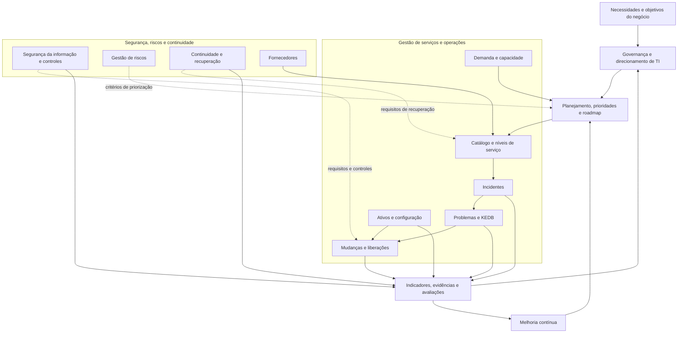

# Arquitetura Técnica do Programa SGS/SGSI

## 1. Objetivo

Descrever a arquitetura conceitual do Programa Integrado de Governança, Serviços e Segurança de TI (SGS/SGSI), seus domínios funcionais e os principais relacionamentos entre governança, processos operacionais, segurança, continuidade e melhoria contínua.

Este material é um artefato conceitual para portfólio profissional. Não representa uma arquitetura implantada ou aprovada por uma organização real.

## 2. Princípios arquiteturais

- **Alinhamento ao negócio:** decisões e prioridades de TI devem considerar objetivos, necessidades e impactos para o negócio.
- **Integração de processos:** processos relacionados devem compartilhar informações, critérios de priorização e mecanismos de escalonamento.
- **Responsabilidade definida:** cada processo, serviço, controle e indicador deve possuir papéis e alçadas claramente definidos.
- **Gestão baseada em risco:** controles e procedimentos devem ser proporcionais à criticidade, ao impacto e ao risco.
- **Rastreabilidade:** decisões, mudanças, incidentes, riscos e resultados devem produzir registros verificáveis.
- **Melhoria contínua:** indicadores, avaliações e lições aprendidas devem alimentar ações de melhoria.

## 3. Domínios funcionais

| Domínio | Escopo conceitual |
|---|---|
| Governança e direcionamento | Estratégia, prioridades, decisões, responsabilidades e acompanhamento executivo. |
| Gestão de serviços | Catálogo, níveis de serviço, incidentes, problemas, mudanças e liberações. |
| Operações e configuração | Ativos, itens de configuração, capacidade e informações operacionais. |
| Segurança e riscos | Riscos de segurança da informação, controles, vulnerabilidades e tratamento de exceções. |
| Continuidade | Criticidade dos serviços, estratégias de recuperação, testes e planos de continuidade. |
| Fornecedores e custos | Desempenho de fornecedores, demanda, capacidade, custos e FinOps. |
| Desempenho e melhoria | Indicadores, avaliações, ações corretivas e melhoria contínua. |

## 4. Diagrama conceitual

O diagrama representa relações funcionais propostas, não uma sequência obrigatória de execução nem uma arquitetura técnica de infraestrutura.

## 5. Relações e dependências relevantes

### 5.1 Governança e planejamento

A governança conecta as necessidades do negócio à priorização das iniciativas, ao acompanhamento do desempenho e às decisões sobre riscos, capacidade e recursos.

### 5.2 Incidentes, problemas e mudanças

Incidentes fornecem dados para identificar problemas recorrentes. A análise de problemas pode gerar correções estruturais, que devem ser avaliadas e controladas pelo processo de mudanças quando aplicável.

### 5.3 Ativos e configuração

Informações sobre ativos e relacionamentos entre componentes apoiam a análise de impacto de incidentes, mudanças, vulnerabilidades e cenários de continuidade. A confiabilidade dessas decisões depende da qualidade e atualização dos dados.

### 5.4 Segurança, riscos e continuidade

Segurança, gestão de riscos e continuidade são domínios transversais. Seus requisitos devem influenciar a priorização, o desenho dos processos, as mudanças e os critérios de recuperação dos serviços.

### 5.5 Indicadores e melhoria contínua

Os registros operacionais e as avaliações de controles alimentam indicadores e evidências. A análise dos resultados deve apoiar decisões e ações de melhoria, sem presumir que a existência de um indicador comprova eficácia ou conformidade.

## 6. Governança da arquitetura

A manutenção da arquitetura deve contemplar:

- responsável pela definição e atualização;
- registro das alterações e respectivas justificativas;
- avaliação dos impactos sobre processos e documentos relacionados;
- revisão de riscos, dependências e controles;
- validação das mudanças pelas autoridades competentes, quando aplicável.

Os papéis e as alçadas devem ser definidos conforme a estrutura organizacional real. No contexto deste portfólio, são propostas conceituais.

## 7. Horizonte de evolução

O planejamento de referência considera implantação inicial em até 90 dias e evolução/maturação de até 18 meses. O sequenciamento depende de escopo, criticidade, capacidade, dados disponíveis e dependências.

Esses horizontes não constituem compromissos de execução aprovados.

## 8. Documentos relacionados

- [README da arquitetura](README.md)
- [Documento Mestre SGS/SGSI](../docs/Documento_Mestre_SGS_SGSI_v1_1_revisado.docx)
- [Diagnóstico Executivo SGS/SGSI](../docs/Diagnostico_Executivo_SGS_SGSI_v1_2_revisado.docx)
- [Roadmap Consolidado SGS/SGSI](../docs/Roadmap_Consolidado_SGS_SGSI_v1_1_revisado.docx)
- [Glossário e Matriz RACI](../docs/Glossario_Matriz_RACI_Integrados_SGS_SGSI_v1_0.docx)
- [Dicionário Corporativo de KPIs](../docs/Dicionario_Corporativo_KPIs_SGS_SGSI_v1_0.docx)
- [Registro Integrado de Riscos, Premissas e Dependências](../docs/Registro_Integrado_Riscos_Premissas_Dependencias_SGS_SGSI_v1_0.docx)

## 9. Limitações

Esta arquitetura é uma proposta de referência. A aplicação prática exige validação de requisitos, riscos, responsabilidades, tecnologias, integrações, controles e capacidade organizacional. A presença de conceitos ou referências metodológicas não significa conformidade integral, certificação ou implantação efetiva.
