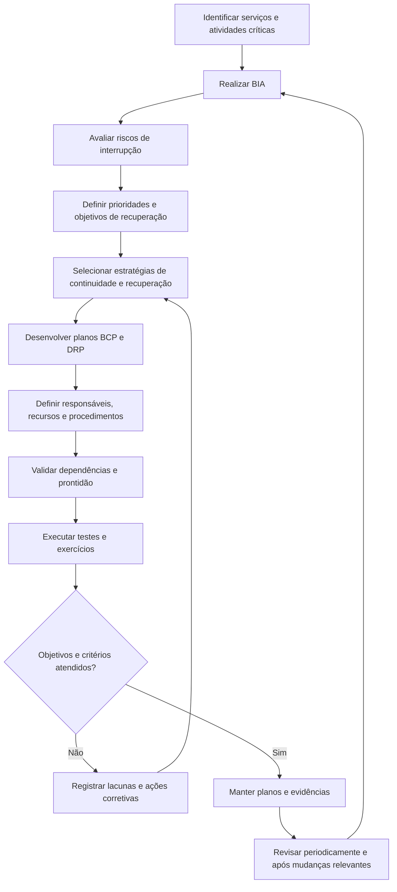

# Gestão de Continuidade de TI (ITSCM/DRP/BCP)

## 1. Objetivo

Estabelecer um modelo conceitual para planejar, preparar, responder e recuperar serviços de tecnologia diante de interrupções que possam comprometer operações, informações, infraestrutura ou atividades críticas do negócio.

O processo busca reduzir os impactos das interrupções, definir prioridades de recuperação, estabelecer estratégias compatíveis com os riscos identificados e promover testes periódicos dos procedimentos de continuidade e recuperação.

Este processo integra o programa conceitual de Sistema de Gestão de Serviços (SGS) e Sistema de Gestão de Segurança da Informação (SGSI).

> **Natureza do documento:** material conceitual desenvolvido para demonstração de conhecimento técnico e capacidade de estruturação de processos. Não representa uma implementação real, nem comprova a adoção deste processo por uma organização.

## 2. Escopo

O modelo contempla o planejamento e a coordenação de atividades relacionadas a:

- Gestão de Continuidade de Serviços de TI (ITSCM).
- Análise de Impacto no Negócio (BIA).
- Avaliação de riscos de interrupção.
- Definição de objetivos e prioridades de recuperação.
- Planejamento de Recuperação de Desastres (DRP).
- Integração com o Plano de Continuidade de Negócios (BCP).
- Estratégias de recuperação de infraestrutura, sistemas, dados e serviços.
- Testes, exercícios, manutenção e melhoria dos planos.

A aplicação efetiva deve considerar os requisitos de negócio, as dependências tecnológicas, os contratos, os riscos, os recursos disponíveis e as responsabilidades formalmente estabelecidas.

## 3. Conceitos fundamentais

| Conceito | Definição operacional proposta |
|---|---|
| ITSCM | Gestão da continuidade dos serviços de TI, incluindo preparação, planejamento, recuperação e melhoria dos mecanismos de continuidade. |
| BIA (*Business Impact Analysis*) | Análise dos impactos de uma interrupção sobre atividades, processos e objetivos do negócio ao longo do tempo. |
| DRP (*Disaster Recovery Plan*) | Plano para recuperar sistemas, infraestrutura, dados e recursos tecnológicos após uma interrupção ou desastre. |
| BCP (*Business Continuity Plan*) | Plano mais amplo para manter ou restabelecer atividades prioritárias do negócio durante e após uma interrupção. |
| RTO (*Recovery Time Objective*) | Tempo-alvo definido para recuperar um serviço, sistema ou atividade após uma interrupção. |
| RPO (*Recovery Point Objective*) | Ponto máximo de perda de dados, expresso como intervalo de tempo aceitável entre o estado recuperado e o momento da interrupção. |
| MTPD (*Maximum Tolerable Period of Disruption*) | Período máximo de interrupção que a organização considera tolerável antes que os impactos se tornem inaceitáveis. |
| Estratégia de recuperação | Conjunto de recursos, procedimentos e alternativas selecionados para restabelecer serviços dentro dos objetivos estabelecidos. |

RTO, RPO e MTPD são conceitos distintos. Os objetivos devem ser definidos com base nas necessidades do negócio, nas dependências e na viabilidade técnica e financeira. Não devem ser tratados como metas genéricas aplicáveis igualmente a todos os serviços.

## 4. Relação entre BIA, RTO, RPO e MTPD

A BIA fornece informações para priorizar atividades e serviços, compreender consequências da interrupção e estabelecer objetivos de recuperação.

- **MTPD:** delimita o período máximo de interrupção considerado tolerável para a atividade ou o serviço.
- **RTO:** estabelece o tempo-alvo para restabelecer o serviço ou recurso necessário.
- **RPO:** estabelece a tolerância à perda de dados, considerando o ponto de recuperação aceitável.

Os objetivos devem ser coerentes entre si e com as necessidades operacionais. Em geral, o RTO precisa ser inferior ao MTPD, deixando margem para validar a recuperação e estabilizar a operação. A viabilidade dos objetivos depende da arquitetura, das tecnologias, dos recursos e dos procedimentos disponíveis.

## 5. Fluxo conceitual do processo

O fluxo é uma referência conceitual. A ativação real dos planos depende de critérios de acionamento, autoridade decisória, comunicação e procedimentos de resposta formalmente definidos.

## 6. Análise de Impacto no Negócio (BIA)

A BIA deve identificar atividades prioritárias, consequências de interrupção e recursos necessários para a continuidade.

Aspectos a avaliar:

- Atividades e serviços essenciais.
- Impactos financeiros, operacionais, legais, regulatórios e reputacionais.
- Efeitos da interrupção ao longo do tempo.
- Dependências entre áreas, serviços, aplicações, dados e infraestrutura.
- Necessidades de pessoas, instalações, fornecedores e comunicações.
- Períodos críticos de operação e sazonalidade.
- Requisitos de recuperação e tolerância à interrupção.
- Alternativas temporárias para manter atividades prioritárias.

A análise deve ser conduzida com participação das áreas de negócio e dos responsáveis pelos serviços. A criticidade não deve ser definida exclusivamente pela equipe técnica de TI.

## 7. Avaliação de riscos de continuidade

A avaliação de riscos busca compreender eventos que possam interromper serviços ou comprometer sua recuperação.

Entre os cenários que podem ser considerados estão:

- Indisponibilidade de infraestrutura, energia ou conectividade.
- Falhas de hardware, armazenamento, virtualização ou plataformas.
- Corrupção, perda ou indisponibilidade de dados.
- Incidentes de segurança, incluindo ransomware e comprometimento de credenciais.
- Indisponibilidade de fornecedores ou serviços em nuvem.
- Erros operacionais e mudanças malsucedidas.
- Falta de pessoal-chave ou de acesso a instalações.
- Falhas em procedimentos de recuperação ou comunicação.

Para cada cenário relevante, devem ser identificados impacto, probabilidade ou plausibilidade, controles existentes, dependências, risco residual e ações de tratamento.

Os cenários efetivamente aplicáveis devem ser definidos a partir do contexto e das evidências da organização, sem presumir que todos tenham a mesma relevância.

## 8. Estratégias de continuidade e recuperação

A estratégia deve ser selecionada considerando os objetivos de recuperação, o risco, os custos e a capacidade operacional.

| Estratégia | Aplicação potencial | Pontos de atenção |
|---|---|---|
| Backup e restauração | Recuperação de dados e sistemas a partir de cópias disponíveis. | Retenção, integridade, proteção contra alteração e testes de restauração. |
| Replicação de dados | Reduzir a perda de dados e acelerar a recuperação. | Consistência, latência, replicação de dados comprometidos e dependências. |
| Ambiente alternativo | Recuperar serviços em infraestrutura distinta. | Capacidade, conectividade, licenciamento, configuração e prontidão. |
| Redundância de componentes | Reduzir pontos únicos de falha. | Dependências compartilhadas e possibilidade de falha simultânea. |
| Procedimentos manuais temporários | Manter atividades prioritárias enquanto sistemas estão indisponíveis. | Capacidade, segurança, duração tolerável e reconciliação posterior. |
| Recuperação contratada de terceiros | Utilizar recursos ou serviços externos para apoiar a recuperação. | Obrigações contratuais, tempos de atendimento e dependências do fornecedor. |

A existência de backups ou infraestrutura redundante não comprova, isoladamente, a capacidade de recuperação. A eficácia depende de testes, procedimentos, recursos e evidências de que os objetivos podem ser atingidos.

## 9. Estrutura mínima de um plano DRP

Um plano de recuperação de desastres pode contemplar:

1. Objetivo, escopo e serviços cobertos.
2. Critérios de acionamento e autoridade para declarar o desastre.
3. Papéis, contatos e cadeia de escalonamento.
4. Inventário de recursos, sistemas e dependências necessários.
5. Pré-requisitos técnicos e acessos de emergência controlados.
6. Sequência de recuperação e prioridades.
7. Procedimentos de recuperação de dados e sistemas.
8. Validação técnica e funcional dos serviços recuperados.
9. Comunicação às partes interessadas.
10. Procedimentos de contingência e escalonamento quando a recuperação falhar.
11. Critérios para retorno à operação normal.
12. Registro de decisões, evidências e lições aprendidas.

Os procedimentos detalhados devem ser armazenados com controles de acesso adequados. Informações sensíveis, credenciais, detalhes de infraestrutura crítica e contatos pessoais não devem ser expostos publicamente no portfólio.

## 10. Testes e exercícios

Os testes devem avaliar se os planos são compreensíveis, executáveis e adequados aos objetivos de recuperação.

| Tipo de exercício | Finalidade |
|---|---|
| Revisão documental | Verificar atualidade, completude, contatos, responsabilidades e coerência dos planos. |
| Exercício de mesa | Simular um cenário para avaliar decisões, comunicação, responsabilidades e escalonamento. |
| Teste técnico controlado | Verificar componentes ou procedimentos específicos de recuperação em ambiente apropriado. |
| Teste de restauração de backup | Confirmar a capacidade de recuperar dados e validar sua integridade. |
| Simulação integrada | Avaliar a coordenação entre equipes, serviços e dependências em um cenário planejado. |
| Teste de recuperação ponta a ponta | Verificar a recuperação de um serviço de acordo com o escopo, os critérios e as salvaguardas aprovados. |

A frequência, a abrangência e o grau de realismo devem ser definidos segundo criticidade e risco. Testes que possam afetar produção exigem planejamento, autorização, salvaguardas e critérios de interrupção.

Cada exercício deve registrar objetivo, escopo, participantes, cenário, resultados, limitações, desvios e ações corretivas. Um teste bem-sucedido em escopo restrito não comprova automaticamente a capacidade integral de recuperação do negócio.

## 11. Papéis e responsabilidades

| Papel | Responsabilidade proposta |
|---|---|
| Patrocinador executivo | Apoiar prioridades, recursos e decisões de continuidade em nível organizacional. |
| Responsável por continuidade de negócio | Coordenar requisitos de continuidade e articulação com as áreas de negócio. |
| Gestor de continuidade de TI | Coordenar estratégias, planos, testes e ações de melhoria da continuidade tecnológica. |
| Gestores de serviço | Identificar dependências, requisitos de recuperação e critérios de validação. |
| Equipes técnicas | Desenvolver e executar procedimentos de recuperação sob sua responsabilidade. |
| Segurança da Informação | Apoiar avaliação de riscos e requisitos de segurança durante contingência e recuperação. |
| Gestão de fornecedores | Coordenar dependências externas e verificar compromissos de recuperação contratados. |
| Áreas de negócio | Definir prioridades, impactos toleráveis e condições para retomada das atividades. |

A distribuição definitiva das responsabilidades deve considerar a estrutura organizacional, as alçadas de decisão e a segregação de funções aplicável.

## 12. Integração com outros processos

| Processo relacionado | Integração proposta |
|---|---|
| Gestão de Incidentes | Identificar interrupções que possam exigir procedimentos de continuidade ou recuperação. |
| Gestão de Problemas e KEDB | Incorporar aprendizados de falhas recorrentes e deficiências técnicas que afetem a recuperação. |
| Gestão de Mudanças e Liberações | Avaliar o impacto de alterações sobre planos, dependências e capacidade de recuperação. |
| Gestão de Segurança da Informação | Integrar resposta a incidentes de segurança, preservação de evidências e recuperação segura. |
| Gestão de Ativos e CMDB | Manter informações sobre componentes, relacionamentos e dependências dos serviços. |
| Gestão de Fornecedores | Avaliar a continuidade dos serviços externos e a disponibilidade de recursos contratados. |
| Gestão de Capacidade | Verificar se os recursos de recuperação suportam a carga necessária. |
| Gestão de Nível de Serviço | Alinhar objetivos de recuperação aos requisitos de serviço e às expectativas do negócio. |
| Gestão de Riscos e Auditoria | Acompanhar riscos residuais, evidências de teste e ações corretivas. |

## 13. Indicadores sugeridos

| Indicador | Finalidade |
|---|---|
| Serviços críticos com BIA vigente | Avaliar a cobertura da análise de impacto. |
| Serviços críticos com plano de recuperação documentado | Acompanhar a cobertura documental dos serviços prioritários. |
| Planos revisados no período definido | Avaliar a manutenção e a atualidade dos planos. |
| Testes realizados conforme planejamento | Acompanhar a execução do programa de testes. |
| Taxa de sucesso dos testes | Avaliar os resultados segundo critérios de sucesso formalmente definidos. |
| RTO observado nos testes | Comparar o tempo de recuperação obtido com o objetivo estabelecido. |
| RPO observado nos testes | Avaliar o ponto de recuperação alcançado em relação à tolerância definida. |
| Ações corretivas pendentes | Identificar lacunas conhecidas que ainda exigem tratamento. |
| Dependências críticas sem alternativa definida | Evidenciar exposição a pontos únicos de falha ou dependências relevantes. |

Os indicadores devem possuir fórmula, fonte, periodicidade, responsável e critérios de interpretação. Não há resultados reais ou metas organizacionais estabelecidas neste documento.

## 14. Riscos e pontos de atenção

- Definir objetivos de recuperação sem participação das áreas de negócio.
- Estabelecer RTO ou RPO sem verificar a viabilidade técnica e financeira.
- Manter planos desatualizados após mudanças relevantes.
- Confiar em backups sem testar restaurações.
- Ignorar dependências de fornecedores, pessoas, instalações ou conectividade.
- Realizar testes sem autorização ou salvaguardas adequadas.
- Não registrar resultados, limitações e ações corretivas.
- Recuperar sistemas sem verificar integridade, segurança e funcionamento.
- Expor publicamente informações sensíveis de recuperação.
- Considerar um teste isolado como prova de continuidade integral.

## 15. Implantação conceitual

Uma implantação real deverá considerar os serviços críticos, os requisitos de negócio, os riscos, a arquitetura tecnológica e os recursos disponíveis.

Como sequência inicial de trabalho, propõe-se:

1. Identificar serviços e atividades prioritárias com as áreas de negócio.
2. Conduzir a BIA e avaliar os cenários de interrupção relevantes.
3. Definir objetivos de recuperação e validar sua viabilidade.
4. Selecionar estratégias e recursos de continuidade e recuperação.
5. Desenvolver planos, procedimentos e mecanismos de comunicação.
6. Definir responsáveis, critérios de acionamento e regras de escalonamento.
7. Planejar testes, registrar resultados e tratar as lacunas identificadas.
8. Estabelecer revisão periódica e atualização após mudanças relevantes.

A duração e a sequência dependem da criticidade dos serviços, da maturidade organizacional, das dependências e dos recursos disponíveis.

## 16. Documento de referência

Este arquivo é a síntese navegável do processo no portfólio. Para consultar a documentação de referência mais completa, acesse:

[Projeto 05 — Continuidade de TI (ITSCM/DRP/BCP)](../docs/Projeto_05_Continuidade_ITSCM_DRP_BCP_v1_1_revisado.docx)

Para visualizar os demais processos, consulte o [catálogo de processos](README.md) e o [índice da documentação central](../docs/README.md).

---

*Documento conceitual para portfólio profissional. Não constitui evidência de implantação, operação, auditoria ou certificação de uma organização real.*
