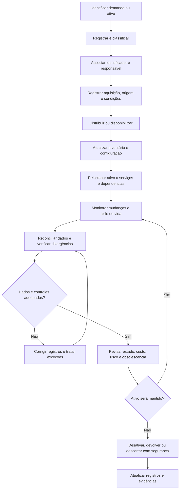

# Gestão de Ativos de TI (ITAM) e CMDB

## 1. Objetivo

Estabelecer um modelo conceitual para controlar os ativos de tecnologia da informação ao longo de seu ciclo de vida e manter informações confiáveis sobre os componentes que suportam os serviços de TI.

O processo integra a Gestão de Ativos de TI (ITAM — *IT Asset Management*) à Gestão de Configuração e à CMDB (*Configuration Management Database*), apoiando decisões operacionais, financeiras, técnicas, de segurança e de governança.

Este processo integra o programa conceitual de Sistema de Gestão de Serviços (SGS) e Sistema de Gestão de Segurança da Informação (SGSI).

> **Natureza do documento:** projeto autoral e conceitual para portfólio profissional. Os modelos, controles, papéis, indicadores e resultados são propostas de referência. Não comprovam implantação ou operação real em uma organização.

## 2. Escopo

O modelo contempla, conforme aplicabilidade:

- Identificação e inventário de ativos de TI.
- Classificação, identificação e atribuição de responsáveis.
- Gestão do ciclo de vida dos ativos.
- Controle de aquisição, recebimento, distribuição, movimentação e devolução.
- Acompanhamento de garantias, contratos, licenças e obsolescência.
- Gestão de configurações e relacionamentos entre componentes.
- Integração com incidentes, problemas, mudanças, segurança e continuidade.
- Conciliação entre inventário físico, registros financeiros e ferramentas de descoberta.
- Desativação, descarte e sanitização de ativos e dados.

O escopo definitivo deve estabelecer quais classes de ativos serão controladas, quais fontes serão utilizadas e quais responsabilidades caberão às equipes técnicas, financeiras, de segurança, compras e demais áreas envolvidas.

## 3. Conceitos fundamentais

| Conceito | Definição operacional proposta |
|---|---|
| Ativo de TI (ITAM) | Recurso tecnológico com valor ou relevância operacional, financeira, contratual ou de segurança, acompanhado ao longo de seu ciclo de vida. |
| Item de Configuração (CI) | Componente que precisa ser gerenciado para entregar ou suportar um serviço de TI. |
| CMDB | Base de dados que registra itens de configuração e seus relacionamentos relevantes para a gestão dos serviços. |
| Inventário de ativos | Registro dos ativos conhecidos, suas características, localização, situação e responsabilidade. |
| Ciclo de vida | Etapas pelas quais um ativo passa, desde a demanda e aquisição até a devolução, desativação ou descarte. |
| Responsável pelo ativo | Pessoa ou função designada para responder pelo controle, uso ou gestão do ativo, conforme o modelo adotado. |
| Descoberta de ativos | Processo de identificar ativos e configurações por meios manuais, automatizados ou integrados. |
| Reconciliação | Comparação de registros de fontes diferentes para identificar divergências, duplicidades e itens desconhecidos. |

ITAM e CMDB são relacionados, mas não equivalentes. O ITAM enfatiza o controle dos ativos e de seu ciclo de vida; a CMDB enfatiza informações de configuração e relacionamentos necessários à gestão dos serviços.

Nem todo ativo precisa ser modelado como item de configuração com o mesmo nível de detalhe. O nível de controle deve refletir criticidade, risco, custo e utilidade operacional.

## 4. Princípios de gestão

- **Identificação única:** manter identificadores consistentes para reduzir duplicidades e ambiguidades.
- **Responsabilidade definida:** associar ativos e itens de configuração a responsáveis ou funções pertinentes.
- **Dados confiáveis:** estabelecer fontes oficiais, regras de atualização e procedimentos de reconciliação.
- **Controle de ciclo de vida:** registrar eventos relevantes desde a aquisição até a destinação final.
- **Proporcionalidade:** aplicar controles conforme valor, criticidade, exposição e risco.
- **Rastreabilidade:** manter histórico de movimentações, alterações e decisões relevantes.
- **Integração:** relacionar ativos e configurações aos serviços, incidentes, mudanças e riscos que dependem deles.
- **Proteção da informação:** restringir acesso aos dados de inventário e configuração conforme sua sensibilidade.

## 5. Categorias de ativos

A classificação deve refletir a realidade tecnológica e os objetivos de controle da organização.

| Categoria | Exemplos |
|---|---|
| Endpoints | Notebooks, desktops, estações especializadas e dispositivos móveis. |
| Infraestrutura | Servidores, equipamentos de rede, armazenamento e componentes de data center. |
| Software e licenças | Sistemas operacionais, aplicações, ferramentas corporativas e direitos de uso. |
| Serviços em nuvem | Recursos de computação, armazenamento, rede e serviços gerenciados. |
| Dispositivos e periféricos | Impressoras, monitores, periféricos e equipamentos especializados. |
| Ativos de segurança | Firewalls, appliances, dispositivos de autenticação e componentes de proteção. |
| Itens de configuração lógica | Aplicações, serviços, bancos de dados, integrações e componentes relevantes à operação. |
| Ativos de informação | Conjuntos de dados e repositórios que exigem controle e proteção específicos. |

A classificação deve evitar a inclusão indiscriminada de todos os elementos técnicos na CMDB. O objetivo é manter dados úteis, confiáveis e proporcionais às necessidades de gestão.

## 6. Fluxo conceitual do processo

O fluxo representa uma proposta conceitual. As aprovações, os sistemas de registro, os critérios de reconciliação e as regras de descarte deverão ser definidos conforme a governança da organização.

## 7. Ciclo de vida dos ativos

| Etapa | Atividades principais | Registros ou controles esperados |
|---|---|---|
| Planejamento da demanda | Identificar necessidade, finalidade, quantidade, requisitos e orçamento. | Solicitação, justificativa e aprovação aplicável. |
| Aquisição | Registrar fornecedor, pedido, custos e condições contratuais. | Pedido, documento fiscal, contrato e identificadores disponíveis. |
| Recebimento | Conferir item, quantidade, especificação e condição. | Registro de recebimento e divergências. |
| Registro | Criar registro do ativo e associar identificador, categoria e responsável. | Inventário atualizado. |
| Preparação e distribuição | Configurar, proteger e disponibilizar o ativo para uso autorizado. | Registro de configuração, entrega e aceite quando aplicável. |
| Operação | Acompanhar localização, responsável, estado, suporte e alterações. | Histórico de movimentações e manutenção. |
| Manutenção e renovação | Avaliar falhas, garantia, custo, desempenho e obsolescência. | Histórico de manutenção e decisão de renovação. |
| Devolução ou transferência | Registrar mudança de responsável, localização ou condição de uso. | Termo ou registro de movimentação. |
| Desativação e descarte | Revogar acessos, remover dados e tratar o ativo conforme requisitos aplicáveis. | Aprovação, evidências de sanitização e comprovante de destinação quando aplicável. |

Os registros devem refletir eventos efetivamente ocorridos. O modelo de portfólio não constitui evidência de que essas etapas foram executadas em um ambiente real.

## 8. Estrutura mínima do registro de ativo

O conjunto de campos deve ser adaptado por categoria de ativo.

| Campo | Finalidade |
|---|---|
| Identificador único | Permitir referência consistente ao ativo. |
| Categoria e descrição | Identificar a natureza e as características principais. |
| Fabricante, modelo e número de série | Apoiar identificação, suporte e garantia, quando aplicável. |
| Estado do ciclo de vida | Registrar se está em aquisição, estoque, uso, manutenção, devolução ou desativado. |
| Responsável | Identificar a pessoa, função ou unidade responsável. |
| Localização | Registrar local físico ou contexto lógico relevante, respeitando a sensibilidade dos dados. |
| Data de aquisição e custo | Apoiar controle financeiro e análise do ciclo de vida. |
| Garantia e contrato | Registrar condições de suporte e datas relevantes. |
| Centro de custo ou unidade | Apoiar alocação financeira e gestão patrimonial, quando aplicável. |
| Serviço relacionado | Associar o ativo aos serviços que suporta, quando conhecido. |
| Criticidade e classificação | Apoiar priorização, proteção e gestão de riscos. |
| Histórico de alterações | Preservar rastreabilidade de movimentações e atualizações. |
| Destinação final | Registrar devolução, descarte, transferência ou outra saída do ciclo de vida. |

Os campos obrigatórios devem ser definidos por categoria e finalidade. Dados pessoais, detalhes de infraestrutura crítica e informações sensíveis devem ser protegidos por controles de acesso adequados.

## 9. Modelagem da CMDB e relacionamentos

A CMDB deve registrar os itens de configuração relevantes e as relações necessárias para compreender os serviços e avaliar os impactos de alterações ou falhas.

Exemplos de relacionamentos conceituais:

- Um serviço depende de uma aplicação.
- Uma aplicação utiliza um banco de dados.
- Uma aplicação depende de componentes de infraestrutura.
- Um serviço depende de conectividade ou de um fornecedor externo.
- Um item de configuração é suportado por um contrato ou equipe responsável.
- Uma mudança afeta um ou mais itens de configuração.
- Um incidente está associado a um serviço ou componente afetado.

Os relacionamentos devem ser mantidos de acordo com critérios definidos e validados. Informações incompletas ou incorretas na CMDB podem levar a avaliações de impacto equivocadas.

A CMDB não deve ser tratada como fonte automaticamente confiável apenas por existir. É necessário estabelecer responsáveis pelos dados, fontes oficiais, regras de atualização e mecanismos de reconciliação.

## 10. Reconciliação e qualidade dos dados

A qualidade do inventário e da CMDB deve ser avaliada por rotinas de comparação entre fontes de dados relevantes, como registros patrimoniais, ferramentas de descoberta, sistemas de gestão de endpoints e registros contratuais.

A rotina pode contemplar:

1. Definir as fontes oficiais para cada atributo.
2. Estabelecer frequência e escopo de reconciliação.
3. Identificar itens ausentes, duplicados ou divergentes.
4. Verificar a origem e a relevância das divergências.
5. Atribuir responsáveis pela correção.
6. Registrar exceções e justificativas.
7. Atualizar os registros após validação.
8. Acompanhar pendências e reincidências.

A descoberta automatizada pode complementar o inventário, mas não substitui controles financeiros, contratuais, patrimoniais ou a validação de itens que não sejam detectáveis pelas ferramentas utilizadas.

## 11. Controles de governança e segurança

Os controles devem ser proporcionais à criticidade e ao risco dos ativos.

O modelo pode contemplar:

- Atribuição de responsáveis pelos ativos e itens de configuração.
- Aprovação e rastreabilidade de aquisições, movimentações e baixas.
- Reconciliação periódica entre inventário e fontes relevantes.
- Restrição de acesso aos registros sensíveis.
- Proteção de ativos e dados durante transporte, manutenção e devolução.
- Verificação de garantia, contratos, licenças e obsolescência.
- Revogação de acessos e remoção de dados em desativações.
- Sanitização ou destruição segura de mídias conforme os requisitos aplicáveis.
- Atualização da CMDB após mudanças relevantes.
- Tratamento de ativos desconhecidos ou não autorizados.

A existência de um registro de ativo não comprova que ele esteja seguro, atualizado ou em conformidade. Os controles precisam ser avaliados por evidências e resultados.

## 12. Papéis e responsabilidades

| Papel | Responsabilidade proposta |
|---|---|
| Gestor de ITAM | Coordenar as regras do ciclo de vida, o inventário, a qualidade dos dados e os controles de ativos. |
| Gestor de configuração | Definir padrões de modelagem, itens de configuração e relacionamentos na CMDB. |
| Responsável pelo ativo | Responder pelo uso, condição, finalidade e informações do ativo sob sua responsabilidade, conforme as regras definidas. |
| Equipe de suporte | Atualizar registros de entrega, movimentação, manutenção e devolução sob sua atuação. |
| Infraestrutura e aplicações | Manter informações técnicas e relacionamentos dos componentes relevantes. |
| Compras e gestão de fornecedores | Fornecer dados de aquisição, contratos, garantias e fornecedores. |
| Finanças ou patrimônio | Apoiar conciliação patrimonial e financeira conforme o modelo organizacional. |
| Segurança da Informação | Definir ou apoiar requisitos de proteção, classificação e descarte seguro. |
| Gestão de Mudanças | Garantir que mudanças relevantes considerem os itens de configuração afetados. |
| Auditoria ou controles internos | Avaliar, conforme mandato, a qualidade dos registros e a aderência aos controles estabelecidos. |

A estrutura pode variar conforme porte e complexidade. A matriz RACI deve definir quem executa, aprova, é consultado e é informado para cada atividade relevante.

## 13. Integração com outros processos

| Processo relacionado | Integração proposta |
|---|---|
| Gestão de Incidentes | Identificar os ativos e componentes afetados para apoiar diagnóstico e restauração. |
| Gestão de Problemas e KEDB | Correlacionar falhas recorrentes a ativos e configurações. |
| Gestão de Mudanças e Liberações | Atualizar os registros afetados por alterações autorizadas. |
| Gestão de Segurança da Informação | Identificar ativos relevantes para avaliação de riscos e aplicação de controles. |
| Gestão de Continuidade de TI | Identificar dependências tecnológicas necessárias à recuperação. |
| Gestão de Nível de Serviço | Relacionar componentes aos serviços e às dependências relevantes. |
| Gestão de Fornecedores | Associar ativos a contratos, garantias e compromissos externos. |
| Gestão Financeira e Orçamentária | Apoiar custos, renovação, depreciação e decisões de investimento, conforme os sistemas aplicáveis. |
| Gestão de Capacidade | Apoiar análise de recursos instalados e necessidades de expansão ou substituição. |

## 14. Indicadores sugeridos

| Indicador | Finalidade |
|---|---|
| Cobertura de inventário | Avaliar a proporção dos ativos esperados que possuem registro válido. |
| Completude dos registros | Acompanhar o preenchimento dos campos obrigatórios por categoria. |
| Divergências de reconciliação | Identificar inconsistências entre fontes de inventário. |
| Ativos sem responsável identificado | Evidenciar lacunas de responsabilização. |
| Ativos sem localização ou estado confiável | Identificar registros que exigem validação. |
| Ativos obsoletos ou fora de suporte | Apoiar priorização de renovação e tratamento de riscos. |
| Movimentações registradas no prazo | Avaliar a atualização tempestiva dos registros. |
| Licenças e contratos próximos do vencimento | Apoiar planejamento de renovação e prevenção de riscos contratuais. |
| Itens de configuração relacionados a serviços críticos | Avaliar a cobertura dos relacionamentos necessários à análise de impacto. |
| Ativos desativados com evidência de destinação | Acompanhar a completude do processo de saída do ciclo de vida. |

Cada indicador deve ter fórmula, fonte, periodicidade, responsável e critérios de interpretação definidos. As metas devem ser estabelecidas a partir de uma linha de base validada.

## 15. Riscos e pontos de atenção

- Manter inventário incompleto ou desatualizado.
- Utilizar identificadores inconsistentes ou duplicados.
- Não atribuir responsáveis pelos ativos.
- Confundir registros patrimoniais com registros de configuração.
- Manter relacionamentos incorretos na CMDB.
- Alterar componentes sem atualizar os registros correspondentes.
- Ignorar ativos não descobertos por ferramentas automatizadas.
- Perder o controle de licenças, garantias e contratos.
- Descartar equipamentos sem tratamento adequado dos dados.
- Expor informações sensíveis de ativos e infraestrutura.
- Utilizar indicadores sem fontes confiáveis ou regras de cálculo definidas.

## 16. Implantação conceitual

Uma implantação real deverá considerar a qualidade do inventário existente, os sistemas disponíveis, o volume de ativos, a criticidade dos serviços e a capacidade das equipes.

Como sequência inicial de trabalho, propõe-se:

1. Definir o escopo e as categorias de ativos a controlar.
2. Identificar as fontes de dados e estabelecer responsabilidades.
3. Padronizar identificadores, campos e estados do ciclo de vida.
4. Realizar levantamento inicial e identificar lacunas relevantes.
5. Definir regras de modelagem e relacionamentos da CMDB.
6. Estabelecer reconciliação e tratamento de divergências.
7. Integrar o processo com incidentes, mudanças, segurança e continuidade.
8. Definir indicadores e rotinas de revisão.
9. Planejar a evolução conforme criticidade, risco e qualidade dos dados.

A duração e a sequência dependem do contexto organizacional, da maturidade dos registros e das ferramentas disponíveis.

## 17. Documento de referência

Este arquivo é a síntese navegável do processo no portfólio. Para consultar a documentação de referência mais completa, acesse:

[Projeto 07 — Gestão de Ativos e CMDB](../docs/Projeto_07_Gestao_Ativos_CMDB_v1_1_revisado.docx)

Para visualizar os demais processos, consulte o [catálogo de processos](README.md) e o [índice da documentação central](../docs/README.md).

---

*Documento conceitual para portfólio profissional. Não constitui evidência de implantação, operação, auditoria ou certificação de uma organização real.*
