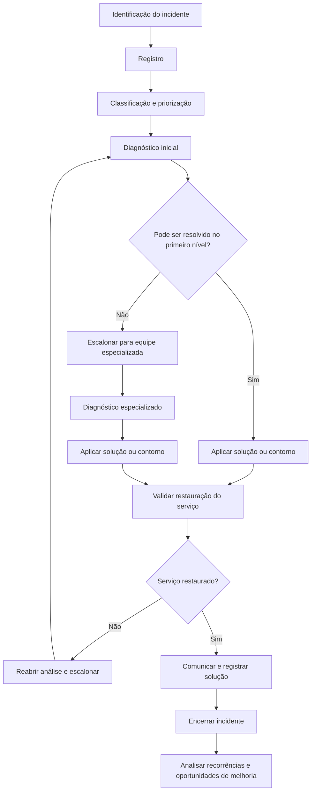

# Gestão de Incidentes de TI

## 1. Objetivo

Estabelecer um modelo conceitual para registrar, classificar, priorizar, diagnosticar, resolver e encerrar incidentes de TI, buscando restaurar os serviços com agilidade, reduzir impactos sobre o negócio e manter a rastreabilidade das ações realizadas.

Este desenho integra o programa conceitual de Sistema de Gestão de Serviços (SGS) e Sistema de Gestão de Segurança da Informação (SGSI).

> **Natureza do documento:** material conceitual desenvolvido para demonstração de conhecimento técnico e capacidade de estruturação de processos. Não representa uma implementação real, nem comprova a adoção deste processo por uma organização.

## 2. Escopo

O processo contempla incidentes relacionados a serviços, sistemas, infraestrutura, equipamentos, acessos e demais recursos de TI abrangidos pelo catálogo de serviços definido pela organização.

Quando houver suspeita de incidente de segurança da informação, o fluxo deve prever o acionamento dos responsáveis pelo SGSI e a aplicação dos procedimentos específicos de segurança, preservação de evidências e comunicação.

O escopo definitivo, os canais de atendimento, os horários de cobertura e as responsabilidades devem ser ajustados ao contexto organizacional.

## 3. Princípios de operação

- **Restauração do serviço:** priorizar a recuperação do serviço afetado, sem dispensar os controles necessários.
- **Priorização por impacto e urgência:** direcionar recursos conforme a criticidade do incidente para o negócio.
- **Registro e rastreabilidade:** manter histórico, classificação, responsáveis, decisões e ações executadas.
- **Comunicação:** informar usuários, áreas afetadas e responsáveis conforme a criticidade e as regras de comunicação estabelecidas.
- **Escalonamento:** encaminhar incidentes para equipes especializadas ou níveis de gestão quando necessário.
- **Aprendizado contínuo:** utilizar dados dos incidentes para identificar problemas recorrentes e oportunidades de melhoria.
- **Integração com segurança:** avaliar sinais de comprometimento da confidencialidade, integridade ou disponibilidade das informações.

## 4. Fluxo conceitual do processo

O fluxo é uma proposta de referência. A organização deverá definir critérios de escalonamento, alçadas de decisão, condições de reabertura e regras de encerramento.

## 5. Etapas e controles

| Etapa | Atividades principais | Evidências ou registros esperados |
|---|---|---|
| Identificação | Receber alertas, solicitações reportadas como incidentes ou notificações de falhas. | Origem e horário da identificação. |
| Registro | Criar registro único com descrição, serviço afetado, usuário ou área e evidências disponíveis. | Identificador e histórico do incidente. |
| Classificação | Categorizar o tipo de falha e relacioná-la ao serviço afetado. | Categoria e serviço relacionado. |
| Priorização | Avaliar impacto e urgência segundo critérios definidos. | Prioridade atribuída e justificativa quando necessária. |
| Diagnóstico inicial | Verificar sintomas, coletar informações e consultar procedimentos conhecidos. | Análises e verificações realizadas. |
| Escalonamento | Direcionar o caso à equipe ou à alçada responsável, conforme a complexidade e a criticidade. | Responsável, horário e motivo do escalonamento. |
| Resolução ou contorno | Aplicar ação corretiva ou alternativa temporária autorizada. | Ações executadas e solução aplicada. |
| Validação | Confirmar a restauração do serviço e avaliar a necessidade de validação com o usuário ou área afetada. | Resultado da validação. |
| Encerramento | Registrar causa conhecida, solução, comunicações e classificação final. | Registro completo e motivo do encerramento. |
| Melhoria | Identificar recorrências, incidentes críticos e oportunidades de abertura de problemas. | Ações de melhoria e referências cruzadas. |

## 6. Matriz de responsabilidades

A matriz abaixo é uma proposta inicial e deve ser adaptada à estrutura e às alçadas da organização.

| Papel | Responsabilidade proposta |
|---|---|
| Usuário ou área solicitante | Relatar o impacto percebido e fornecer informações necessárias ao diagnóstico. |
| Central de Serviços / Service Desk | Registrar, classificar, priorizar conforme critérios definidos, realizar diagnóstico inicial e acompanhar o atendimento. |
| Equipe técnica especializada | Investigar incidentes escalonados, aplicar soluções autorizadas e documentar as ações. |
| Gestor do processo | Acompanhar o desempenho, tratar desvios, revisar critérios e promover melhorias. |
| Gestor do serviço | Apoiar decisões sobre impacto no negócio, prioridades e comunicação com as áreas interessadas. |
| Responsável pelo SGSI | Participar da avaliação e do tratamento quando houver suspeita ou confirmação de incidente de segurança da informação. |
| Gestão de Problemas | Investigar causas subjacentes de incidentes relevantes ou recorrentes. |

Os papéis podem ser acumulados ou distribuídos de maneira diferente conforme porte, estrutura e modelo operacional.

## 7. Critérios de priorização

A prioridade deve considerar, no mínimo, dois fatores:

- **Impacto:** extensão dos efeitos sobre serviços, usuários, operações, obrigações e objetivos de negócio.
- **Urgência:** tempo disponível para agir antes que os efeitos se agravem ou comprometam uma atividade crítica.

Uma matriz de impacto e urgência pode gerar níveis de prioridade, como P1, P2, P3 e P4. Entretanto, os critérios objetivos, os prazos de resposta e restauração e as regras de escalonamento precisam ser definidos e aprovados pela organização.

Não se devem atribuir metas de SLA ou tempos de resolução sem uma base de serviço e capacidade operacional estabelecida.

## 8. Integração com outros processos

| Processo relacionado | Integração proposta |
|---|---|
| Gestão de Problemas e KEDB | Encaminhar incidentes recorrentes ou de causa desconhecida para investigação estruturada; consultar erros conhecidos e soluções de contorno documentadas. |
| Gestão de Mudanças e Liberações | Avaliar se uma mudança contribuiu para o incidente e encaminhar alterações necessárias pelo fluxo de mudança autorizado. |
| Gestão de Nível de Serviço (SLM) | Comparar os resultados do atendimento com os níveis de serviço definidos. |
| Gestão de Ativos e CMDB | Relacionar o incidente aos ativos, componentes e serviços afetados, quando houver dados confiáveis. |
| Gestão da Segurança da Informação (SGSI) | Acionar o fluxo de segurança quando houver indícios de comprometimento ou violação de políticas de segurança. |
| Continuidade de TI | Avaliar o acionamento de procedimentos de continuidade ou recuperação quando o impacto exceder os limites operacionais definidos. |
| Desempenho e Melhoria Contínua | Analisar tendências, recorrências, tempos de atendimento e causas de desvios. |

## 9. Indicadores sugeridos

Os indicadores devem ter definição formal, fonte de dados, periodicidade, responsável e regras de cálculo.

| Indicador | Finalidade |
|---|---|
| Volume de incidentes por período | Acompanhar a demanda e suas variações. |
| Tempo médio de restauração | Avaliar o tempo necessário para restabelecer os serviços. |
| Percentual de incidentes resolvidos no primeiro nível | Avaliar a capacidade de resolução no atendimento inicial. |
| Cumprimento das metas de atendimento | Verificar o desempenho em relação aos níveis de serviço formalmente definidos. |
| Taxa de reabertura | Identificar possíveis falhas de resolução ou validação. |
| Incidentes recorrentes por categoria ou serviço | Identificar candidatos à Gestão de Problemas. |
| Incidentes críticos | Acompanhar ocorrências de alto impacto e suas ações de tratamento. |
| Completude dos registros | Avaliar se os dados necessários para rastreabilidade e análise estão preenchidos. |

Nenhum resultado, percentual ou meta é apresentado aqui como medição real. Os valores de referência devem ser definidos após avaliação da situação inicial e das necessidades do negócio.

## 10. Riscos e pontos de atenção

- Classificação inconsistente entre equipes.
- Priorização sem critérios objetivos de impacto e urgência.
- Escalonamento tardio de incidentes críticos.
- Encerramento sem validação da restauração do serviço.
- Registros incompletos que inviabilizam análise histórica.
- Soluções de contorno não documentadas ou não autorizadas.
- Tratamento inadequado de evidências em incidentes com possível impacto de segurança.
- Ausência de integração entre incidentes, problemas, mudanças, ativos e serviços.

## 11. Implantação conceitual

Uma implantação real deverá começar pelo entendimento do processo atual, dos serviços críticos, das ferramentas, dos papéis e das necessidades dos usuários.

Como sequência inicial de trabalho, propõe-se:

1. Levantar os canais de entrada e o fluxo de atendimento existente.
2. Definir escopo, categorias, matriz de impacto e urgência e regras de prioridade.
3. Estabelecer papéis, escalonamentos e responsabilidades.
4. Padronizar o registro, a comunicação, a validação e o encerramento.
5. Definir indicadores e fontes de dados.
6. Realizar validação com as partes interessadas e planejar uma adoção controlada.
7. Monitorar resultados e revisar o processo com base em evidências.

A duração e a sequência devem ser ajustadas ao porte da organização, à maturidade dos processos, às ferramentas disponíveis e às dependências identificadas.

## 12. Documento de referência

Este arquivo é a síntese navegável do processo no portfólio. Para consultar a documentação de referência mais completa, acesse:

[Projeto 01 — Gestão de Incidentes](../docs/Projeto_01_Gestao_Incidentes_v1_1_revisado.docx)

Para visualizar os demais processos do programa, consulte o [catálogo de processos](README.md) e o [índice da documentação central](../docs/README.md).

---

*Documento conceitual para portfólio profissional. Não constitui evidência de implantação, operação, auditoria ou certificação de uma organização real.*
