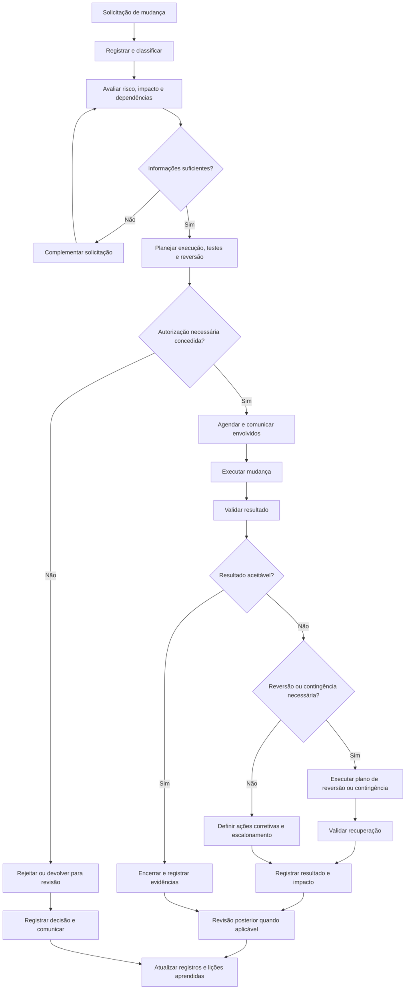

# Gestão de Mudanças e Liberações

## 1. Objetivo

Estabelecer um modelo conceitual para avaliar, autorizar, planejar, executar e revisar mudanças em serviços, sistemas, infraestrutura e componentes tecnológicos, reduzindo riscos de indisponibilidade, falhas operacionais, impactos de segurança e interrupções do negócio.

O processo integra a Gestão de Mudanças à Gestão de Liberações, buscando assegurar que as alterações sejam conduzidas de maneira controlada, rastreável e compatível com os requisitos operacionais e de negócio.

Este processo integra o programa conceitual de Sistema de Gestão de Serviços (SGS) e Sistema de Gestão de Segurança da Informação (SGSI).

> **Natureza do documento:** material conceitual desenvolvido para demonstração de conhecimento técnico e capacidade de estruturação de processos. Não representa uma implementação real, nem comprova a adoção deste processo por uma organização.

## 2. Escopo

O processo contempla mudanças que possam afetar serviços, aplicações, infraestrutura, configurações, ativos tecnológicos, integrações, controles de segurança ou componentes críticos do ambiente de TI.

Inclui:

- Registro e classificação das mudanças.
- Avaliação de risco, impacto e dependências.
- Definição de responsáveis e níveis de autorização.
- Planejamento de execução, testes e comunicação.
- Preparação de contingência e reversão quando aplicável.
- Execução controlada e validação dos resultados.
- Planejamento e coordenação de liberações.
- Revisão posterior e registro de aprendizados.

O escopo definitivo deve estabelecer quais mudanças são abrangidas, quais são tratadas por fluxos específicos e quais alterações exigem controles adicionais.

## 3. Princípios de operação

- **Controle proporcional ao risco:** aplicar rigor compatível com a criticidade e o impacto potencial da mudança.
- **Rastreabilidade:** manter registros de justificativa, avaliação, autorização, execução e resultado.
- **Separação de responsabilidades:** definir quem solicita, avalia, autoriza, executa e valida, conforme o risco e a estrutura organizacional.
- **Planejamento:** avaliar dependências, recursos, janelas de execução e comunicação.
- **Segurança desde o planejamento:** considerar riscos à confidencialidade, integridade e disponibilidade.
- **Reversibilidade:** planejar recuperação ou reversão quando tecnicamente viável.
- **Aprendizado contínuo:** analisar falhas, desvios e resultados para aperfeiçoar o processo.

## 4. Classificação das mudanças

A classificação deve considerar risco, impacto, urgência, complexidade, dependências e histórico de sucesso.

| Tipo de mudança | Características | Tratamento proposto |
|---|---|---|
| Padrão | Recorrente, de baixo risco, previamente avaliada e executada por procedimento autorizado. | Fluxo predefinido, com critérios de elegibilidade, documentação e revisão periódica. |
| Normal | Requer avaliação específica de impacto, risco, planejamento e autorização. | Análise e autorização conforme alçadas definidas. |
| Emergencial | Necessária para tratar incidente grave, vulnerabilidade relevante ou risco imediato ao negócio. | Fluxo acelerado com autorização emergencial, registro obrigatório e revisão posterior. |

A organização deve definir critérios objetivos para cada tipo. Uma mudança urgente não deve ser classificada automaticamente como emergencial sem justificativa compatível com os critérios estabelecidos.

## 5. Fluxo conceitual do processo

Este fluxo é uma referência conceitual. As condições de autorização, os critérios de reversão e as regras para mudanças emergenciais deverão ser formalizados conforme a governança da organização.

## 6. Etapas e controles

| Etapa | Atividades principais | Evidências ou registros esperados |
|---|---|---|
| Solicitação | Registrar objetivo, justificativa, escopo e componentes afetados. | Registro único da mudança. |
| Classificação | Identificar tipo, criticidade, urgência e fluxo de tratamento aplicável. | Categoria e justificativa. |
| Avaliação | Analisar riscos, impacto, dependências, segurança, continuidade e possíveis efeitos colaterais. | Avaliação técnica e de risco. |
| Planejamento | Definir responsáveis, cronograma, janela, recursos, testes, comunicação e contingência. | Plano de implementação e recuperação. |
| Autorização | Submeter a mudança às alçadas responsáveis, conforme critérios estabelecidos. | Decisão, responsável e data. |
| Agendamento | Coordenar a janela com áreas, serviços e outras mudanças dependentes. | Agenda e comunicações. |
| Execução | Aplicar os procedimentos aprovados e registrar desvios relevantes. | Evidências de execução e horários. |
| Validação | Verificar critérios de sucesso, integridade, segurança e funcionamento dos serviços. | Resultados dos testes e validação. |
| Reversão ou contingência | Aplicar o plano previsto quando os critérios de falha ou risco forem atingidos. | Registro das ações e resultado da recuperação. |
| Encerramento | Registrar resultado, impacto, pendências e documentação atualizada. | Estado final e histórico da mudança. |
| Revisão posterior | Analisar falhas, desvios, mudanças emergenciais ou resultados inesperados. | Lições aprendidas e ações de melhoria. |

## 7. Avaliação de risco e impacto

A análise deve ser proporcional à complexidade e à criticidade da mudança.

Entre os fatores a considerar estão:

- Quantidade e criticidade dos serviços afetados.
- Impacto potencial sobre usuários e operações de negócio.
- Dependências técnicas e integrações.
- Efeitos sobre disponibilidade, desempenho e capacidade.
- Riscos à confidencialidade, integridade e disponibilidade da informação.
- Requisitos regulatórios, contratuais ou de auditoria aplicáveis.
- Complexidade da execução e possibilidade de reversão.
- Histórico de mudanças semelhantes.
- Existência e qualidade dos testes e evidências de validação.

A avaliação deve registrar os riscos relevantes, as medidas de mitigação e os riscos residuais conhecidos. A aprovação não elimina o risco; representa uma decisão tomada dentro das alçadas e dos critérios de governança definidos.

## 8. Planejamento, testes e reversão

Antes da execução, o plano deve contemplar, conforme aplicável:

1. Objetivo, escopo e componentes afetados.
2. Responsáveis pela execução e pela validação.
3. Pré-requisitos, dependências e recursos necessários.
4. Janela de execução e duração estimada.
5. Procedimento técnico e sequência de atividades.
6. Testes prévios e critérios de aceitação.
7. Comunicação aos usuários e às áreas envolvidas.
8. Critérios para interromper a execução ou iniciar a reversão.
9. Procedimento de recuperação e validação após reversão.
10. Evidências necessárias para encerramento.

A reversão deve ser tecnicamente viável e validada quando possível. Algumas mudanças podem não admitir retorno simples ao estado anterior; nesses casos, devem ser definidos controles alternativos de recuperação e continuidade.

## 9. Gestão de liberações

A Gestão de Liberações coordena a disponibilização de mudanças aprovadas em ambientes de produção ou em outros ambientes controlados.

O planejamento de uma liberação pode incluir:

- Agrupamento e sequenciamento de mudanças relacionadas.
- Identificação de versões, componentes e dependências.
- Verificação de critérios de prontidão.
- Coordenação de testes e validações.
- Preparação de comunicação e suporte pós-implantação.
- Registro da versão disponibilizada e dos componentes alterados.
- Monitoramento inicial e tratamento de falhas.

Mudança e liberação são conceitos relacionados, mas não idênticos: a mudança representa a alteração avaliada e controlada; a liberação organiza a disponibilização de componentes, versões ou alterações para uso.

Os critérios de aprovação, segregação de ambientes, controle de versões e implantação devem ser compatíveis com a arquitetura tecnológica e o modelo operacional adotados.

## 10. Papéis e responsabilidades

| Papel | Responsabilidade proposta |
|---|---|
| Solicitante | Apresentar a necessidade, justificativa e escopo da mudança. |
| Responsável técnico pela mudança | Elaborar avaliação técnica, plano de execução, testes e recuperação. |
| Gestor do serviço | Avaliar impacto sobre o serviço e as áreas de negócio. |
| Autoridade de aprovação | Autorizar, rejeitar ou solicitar ajustes conforme as alçadas estabelecidas. |
| Responsável pela execução | Implementar a mudança de acordo com o plano autorizado e registrar desvios. |
| Responsável pela validação | Confirmar os resultados e os critérios de aceitação, respeitando a segregação de funções definida. |
| Gestão de Mudanças | Coordenar o fluxo, acompanhar registros e monitorar conformidade com o processo. |
| Gestão de Liberações | Coordenar o planejamento e a disponibilização das versões ou conjuntos de alterações. |
| Responsável pelo SGSI | Participar da avaliação quando houver riscos ou impactos relevantes para a segurança da informação. |

Os papéis podem ser acumulados ou distribuídos de maneira diferente conforme o porte, a criticidade e a estrutura organizacional. Mudanças de alto risco podem exigir segregação mais rigorosa entre execução e aprovação.

## 11. Integração com outros processos

| Processo relacionado | Integração proposta |
|---|---|
| Gestão de Incidentes | Mudanças podem ser necessárias para resolver incidentes; falhas após mudanças podem gerar novos incidentes. |
| Gestão de Problemas e KEDB | Investigações podem originar mudanças corretivas; erros conhecidos podem orientar a avaliação de risco. |
| Gestão de Ativos e CMDB | Atualizar os registros de configuração afetados, quando aplicável. |
| Gestão de Segurança da Informação | Avaliar controles de segurança, vulnerabilidades e riscos introduzidos pela alteração. |
| Gestão de Continuidade de TI | Considerar requisitos de recuperação e continuidade para serviços críticos. |
| Gestão de Nível de Serviço | Avaliar efeitos sobre disponibilidade, desempenho e compromissos de serviço. |
| Gestão de Fornecedores | Coordenar atividades de terceiros e responsabilidades contratuais quando aplicável. |
| Melhoria Contínua | Analisar falhas, desvios, retrabalho e oportunidades de aperfeiçoamento. |

## 12. Indicadores sugeridos

| Indicador | Finalidade |
|---|---|
| Volume de mudanças por tipo | Compreender a distribuição entre mudanças padrão, normais e emergenciais. |
| Taxa de sucesso das mudanças | Avaliar a proporção de mudanças concluídas conforme os critérios de sucesso definidos. |
| Taxa de mudanças com falha ou reversão | Identificar problemas de planejamento, execução, teste ou avaliação de risco. |
| Percentual de mudanças emergenciais | Acompanhar o uso do fluxo emergencial e investigar tendências relevantes. |
| Mudanças não autorizadas identificadas | Monitorar desvios de governança e conformidade. |
| Incidentes associados a mudanças | Avaliar impactos operacionais relacionados às alterações. |
| Cumprimento das janelas planejadas | Acompanhar previsibilidade e coordenação das execuções. |
| Completude dos registros | Avaliar a qualidade das evidências de solicitação, avaliação, autorização e encerramento. |
| Revisões posteriores realizadas | Acompanhar a execução das revisões previstas pelos critérios de governança. |

Cada indicador deve ter fórmula, fonte, periodicidade, responsável e critérios de interpretação definidos. Os resultados devem ser analisados considerando o risco e a complexidade das mudanças, evitando conclusões baseadas apenas em volume ou velocidade.

## 13. Riscos e pontos de atenção

- Alterações executadas sem registro ou autorização exigida.
- Avaliação insuficiente de impactos e dependências.
- Testes inadequados ou critérios de aceitação indefinidos.
- Ausência de plano de recuperação para mudanças críticas.
- Comunicação insuficiente às áreas afetadas.
- Conflitos entre janelas de mudanças relacionadas.
- Falta de rastreabilidade entre mudança, liberação, incidente e configuração.
- Uso excessivo do fluxo emergencial.
- Encerramento sem evidências de validação.
- Falta de análise posterior após falhas relevantes.

## 14. Implantação conceitual

Uma implantação real deverá considerar a maturidade operacional, as ferramentas de gestão, a criticidade dos serviços, os controles existentes e as necessidades de auditoria.

Como sequência inicial de trabalho, propõe-se:

1. Mapear os fluxos atuais de solicitação e execução de mudanças.
2. Definir classificação, critérios de risco e alçadas de aprovação.
3. Padronizar os registros de solicitação, avaliação, autorização e encerramento.
4. Definir requisitos de planejamento, testes, comunicação e recuperação.
5. Estabelecer a integração entre mudanças e liberações.
6. Definir indicadores, controles de conformidade e critérios para revisão posterior.
7. Validar o modelo com as partes interessadas e planejar uma adoção controlada.

A duração e a sequência dependem do contexto organizacional, da maturidade dos processos e das ferramentas disponíveis.

## 15. Documento de referência

Este arquivo é a síntese navegável do processo no portfólio. Para consultar a documentação de referência mais completa, acesse:

[Projeto 03 — Gestão de Mudanças e Liberações](../docs/Projeto_03_Gestao_Mudancas_Liberacoes_v1_1_revisado.docx)

Para visualizar os demais processos, consulte o [catálogo de processos](README.md) e o [índice da documentação central](../docs/README.md).

---

*Documento conceitual para portfólio profissional. Não constitui evidência de implantação, operação, auditoria ou certificação de uma organização real.*
