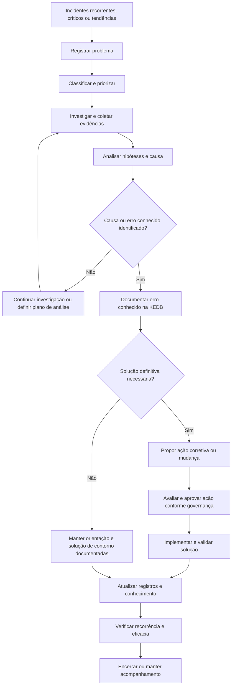

# Gestão de Problemas e KEDB

## 1. Objetivo

Estabelecer um modelo conceitual para identificar, investigar e tratar as causas subjacentes de incidentes, reduzindo recorrências e seus impactos sobre os serviços de TI.

O processo também contempla a manutenção de uma base de erros conhecidos — KEDB (*Known Error Database*) — para disponibilizar informações documentadas sobre causas conhecidas, soluções de contorno e orientações de resolução.

Este processo integra o programa conceitual de Sistema de Gestão de Serviços (SGS) e Sistema de Gestão de Segurança da Informação (SGSI).

> **Natureza do documento:** material conceitual desenvolvido para demonstração de conhecimento técnico e capacidade de estruturação de processos. Não representa uma implementação real, nem comprova a adoção deste processo por uma organização.

## 2. Escopo

O processo contempla:

- Identificação de problemas a partir de incidentes recorrentes, incidentes críticos, tendências e análises proativas.
- Registro e classificação de problemas.
- Investigação técnica e análise de causa-raiz.
- Definição, avaliação e acompanhamento de ações corretivas.
- Identificação e documentação de erros conhecidos.
- Criação, atualização e utilização da KEDB.
- Integração com Gestão de Incidentes, Mudanças, Conhecimento e Melhoria Contínua.

Os critérios de abertura, a profundidade das investigações e a priorização devem ser definidos de acordo com o impacto sobre o negócio, a criticidade dos serviços e a capacidade operacional disponível.

## 3. Conceitos fundamentais

| Conceito | Definição operacional proposta |
|---|---|
| Incidente | Evento que causa ou pode causar interrupção ou redução da qualidade de um serviço de TI. |
| Problema | Causa, ou potencial causa, de um ou mais incidentes que demanda investigação e tratamento. |
| Causa-raiz | Fator fundamental identificado como origem do problema, sustentado por evidências suficientes. |
| Erro conhecido | Problema que foi analisado e para o qual existe causa documentada ou conhecimento suficiente para orientar o tratamento, ainda que a solução definitiva não tenha sido aplicada. |
| Solução de contorno (*workaround*) | Ação temporária que reduz ou elimina o impacto do incidente sem necessariamente remover sua causa subjacente. |
| KEDB | Base de conhecimento que reúne registros de erros conhecidos, sintomas, causas conhecidas, soluções de contorno e orientações de resolução. |
| Ação corretiva | Ação destinada a eliminar ou reduzir a causa identificada e prevenir a recorrência, conforme avaliação e aprovação aplicáveis. |

A KEDB não substitui o registro de incidentes nem o sistema de gestão de conhecimento. Ela deve facilitar a recuperação de informações técnicas úteis ao diagnóstico e à restauração dos serviços.

## 4. Gatilhos para abertura de problemas

Um problema pode ser registrado quando houver, por exemplo:

- Recorrência de incidentes semelhantes.
- Incidente crítico ou de alto impacto que exija investigação posterior.
- Incidente sem causa identificada após o tratamento inicial.
- Tendência de aumento de falhas em determinado serviço, componente ou ativo.
- Falha identificada por monitoramento ou análise proativa, antes de provocar impacto significativo.
- Necessidade de eliminar uma solução de contorno recorrente ou de alto risco.

A abertura de um problema não deve depender exclusivamente de um número fixo de incidentes. Critérios quantitativos podem ser combinados com criticidade, impacto potencial, risco e julgamento técnico documentado.

## 5. Fluxo conceitual do processo

O fluxo é uma referência conceitual. As condições de aprovação, o tratamento de problemas sem causa confirmada e os critérios de encerramento deverão ser adaptados à governança da organização.

## 6. Etapas e controles

| Etapa | Atividades principais | Evidências ou registros esperados |
|---|---|---|
| Identificação | Avaliar incidentes recorrentes, críticos, tendências e sinais de falha. | Incidentes relacionados, alertas ou análise que motivou a abertura. |
| Registro | Criar registro próprio para o problema e relacionar os incidentes associados. | Identificador, descrição, serviço afetado e histórico. |
| Classificação e priorização | Avaliar impacto, recorrência, risco, abrangência e criticidade. | Categoria, prioridade e justificativa. |
| Investigação | Reunir evidências, reproduzir sintomas quando possível e analisar hipóteses. | Evidências, hipóteses, testes e resultados. |
| Análise de causa | Utilizar métodos estruturados para investigar causas contribuintes e subjacentes. | Conclusões sustentadas por evidências e limitações conhecidas. |
| Registro de erro conhecido | Documentar sintomas, causa conhecida, contorno e orientações de tratamento. | Artigo ou registro validado na KEDB. |
| Planejamento de correção | Definir ação, responsáveis, dependências, riscos e critérios de sucesso. | Plano de ação e avaliação de risco. |
| Gestão da mudança | Encaminhar alterações necessárias pelo processo de mudanças aplicável. | Registro, avaliação, aprovação e resultado da mudança. |
| Validação | Avaliar se a ação resolveu a causa e reduziu a recorrência. | Evidências de testes, monitoramento ou análise posterior. |
| Encerramento e melhoria | Atualizar registros, comunicar resultados e registrar aprendizados. | Histórico final, resultados e oportunidades de melhoria. |

## 7. Métodos de análise de causa

A seleção do método deve considerar a complexidade do problema, a disponibilidade de evidências e o impacto potencial.

| Método | Aplicação proposta |
|---|---|
| 5 Porquês | Explorar relações causais em problemas relativamente delimitados, evitando encerrar a análise em sintomas superficiais. |
| Diagrama de Ishikawa | Organizar possíveis causas por categorias e apoiar a investigação de problemas com múltiplos fatores. |
| Análise de Pareto | Identificar categorias de falha que concentram maior volume ou impacto. |
| Análise de linha do tempo | Correlacionar eventos, mudanças, alertas e sintomas para reconstruir a sequência da falha. |
| Análise de causa e efeito | Examinar relações entre componentes, configurações, dependências e efeitos observados. |

A aplicação de uma ferramenta não comprova, por si só, a causa-raiz. A conclusão deve ser proporcional às evidências disponíveis, e hipóteses não confirmadas devem permanecer identificadas como tais.

## 8. Estrutura recomendada para um registro na KEDB

Cada registro deverá conter os campos aplicáveis ao modelo operacional adotado.

| Campo | Finalidade |
|---|---|
| Identificador | Permitir referência única ao erro conhecido. |
| Título e resumo | Facilitar a identificação rápida do problema. |
| Serviço ou componente afetado | Relacionar o conhecimento ao contexto técnico. |
| Sintomas e mensagens de erro | Ajudar a reconhecer ocorrências semelhantes. |
| Incidentes relacionados | Permitir rastreabilidade entre problema e incidentes. |
| Causa conhecida ou hipótese | Descrever o conhecimento confirmado e explicitar incertezas. |
| Solução de contorno | Orientar a mitigação temporária, incluindo restrições e riscos. |
| Solução definitiva ou plano de correção | Documentar a resolução conhecida ou as ações planejadas. |
| Procedimentos e evidências | Registrar testes, instruções, logs ou referências relevantes, respeitando controles de acesso. |
| Responsável técnico | Identificar quem mantém ou valida o conteúdo. |
| Estado do registro | Indicar se está em análise, validado, em revisão, obsoleto ou em outra situação definida. |
| Data de revisão | Apoiar a revisão periódica do conhecimento. |
| Referências a mudanças | Vincular a solução a mudanças ou liberações quando aplicável. |

O conteúdo deve ser revisado quando houver mudança relevante no ambiente, quando a solução deixar de ser válida ou quando novas evidências alterarem o entendimento do problema.

## 9. Papéis e responsabilidades

| Papel | Responsabilidade proposta |
|---|---|
| Central de Serviços / Service Desk | Identificar recorrências, registrar informações úteis e consultar soluções conhecidas. |
| Analista ou especialista técnico | Investigar problemas, documentar evidências e propor soluções ou contornos. |
| Gestor do processo de Problemas | Priorizar o fluxo de trabalho, acompanhar investigações e promover a qualidade dos registros. |
| Gestor do serviço | Avaliar impactos sobre o negócio e apoiar decisões de prioridade. |
| Responsável pela Gestão de Mudanças | Garantir que correções que alterem o ambiente sejam avaliadas e tratadas conforme os controles aplicáveis. |
| Responsável pela KEDB ou pelo conhecimento | Apoiar a qualidade, a organização, a revisão e a disponibilidade dos registros. |
| Responsável pelo SGSI | Participar quando o problema envolver riscos ou eventos relacionados à segurança da informação. |

Os papéis podem ser acumulados ou distribuídos de maneira diferente conforme o porte e a estrutura da organização.

## 10. Integração com outros processos

| Processo relacionado | Integração proposta |
|---|---|
| Gestão de Incidentes | Fornecer dados de recorrência e consumir soluções de contorno para acelerar a restauração. |
| Gestão de Mudanças e Liberações | Controlar alterações necessárias para corrigir causas identificadas. |
| Gestão do Conhecimento | Aplicar padrões de documentação, busca, revisão e controle de acesso ao conteúdo. |
| Gestão de Ativos e CMDB | Relacionar problemas aos componentes e dependências relevantes, quando os dados forem confiáveis. |
| Gestão de Nível de Serviço (SLM) | Avaliar o impacto dos problemas sobre disponibilidade, desempenho e níveis de serviço. |
| Gestão da Segurança da Informação | Integrar investigações relacionadas a vulnerabilidades, falhas de controle ou incidentes de segurança. |
| Melhoria Contínua | Acompanhar ações corretivas, resultados e prevenção de recorrências. |

## 11. Indicadores sugeridos

| Indicador | Finalidade |
|---|---|
| Problemas abertos por período | Acompanhar a entrada de demanda investigativa. |
| Problemas por tempo em aberto | Identificar itens que permanecem sem tratamento por períodos prolongados. |
| Tempo médio de resolução de problemas | Avaliar o tempo entre a abertura e a resolução, com critérios de início e fim definidos. |
| Recorrência de incidentes associados | Avaliar se as ações contribuíram para reduzir a repetição das falhas. |
| Percentual de problemas com causa documentada | Acompanhar a evolução do conhecimento sobre as causas dos problemas. |
| Registros da KEDB revisados no prazo | Avaliar a manutenção e a atualidade da base de erros conhecidos. |
| Uso de soluções de contorno documentadas | Avaliar a utilização prática do conhecimento disponível. |
| Eficácia das ações corretivas | Verificar se as ações produziram o resultado esperado após um período de observação. |

Cada indicador deve ter fórmula, fonte, periodicidade, responsável e limitações documentadas. Os valores e as metas devem ser estabelecidos a partir da situação inicial; este documento não apresenta resultados organizacionais reais.

## 12. Riscos e pontos de atenção

- Confundir sintomas com causa-raiz.
- Encerrar investigações sem evidências suficientes.
- Tratar hipóteses como causas confirmadas.
- Registrar soluções de contorno sem avaliar riscos e restrições.
- Manter artigos desatualizados na KEDB.
- Não relacionar problemas aos incidentes que os originaram.
- Implementar correções sem avaliação de mudança quando ela for necessária.
- Não verificar a eficácia das ações corretivas.
- Expor informações técnicas sensíveis sem controles de acesso adequados.

## 13. Implantação conceitual

Uma implantação real deverá considerar a maturidade da Gestão de Incidentes, a disponibilidade de dados históricos, a estrutura técnica, as ferramentas existentes e a capacidade de investigação.

Como sequência inicial de trabalho, propõe-se:

1. Definir critérios para abertura, classificação e priorização de problemas.
2. Estabelecer papéis, responsabilidades e critérios de escalonamento.
3. Definir um padrão de registro de investigação e análise de causa.
4. Estruturar a KEDB e os critérios de publicação, revisão e obsolescência.
5. Estabelecer a integração com incidentes e mudanças.
6. Definir indicadores e mecanismos de acompanhamento da eficácia.
7. Validar o modelo com as partes interessadas e planejar a adoção controlada.

A duração e a sequência dependem do contexto organizacional, da qualidade dos dados e das ferramentas disponíveis.

## 14. Documento de referência

Este arquivo é a síntese navegável do processo no portfólio. Para consultar a documentação de referência mais completa, acesse:

[Projeto 02 — Gestão de Problemas e KEDB](../docs/Projeto_02_Gestao_Problemas_KEDB_v1_1_revisado.docx)

Para visualizar os demais processos, consulte o [catálogo de processos](README.md) e o [índice da documentação central](../docs/README.md).

---

*Documento conceitual para portfólio profissional. Não constitui evidência de implantação, operação, auditoria ou certificação de uma organização real.*
