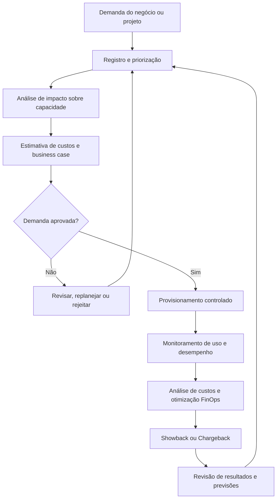

# Gestão de Demanda, Capacidade e FinOps

## 1. Objetivo

Definir um modelo conceitual integrado para a gestão de demanda, capacidade tecnológica e custos de TI, conectando as necessidades do negócio à disponibilidade de recursos computacionais e à eficiência financeira.

O modelo busca apoiar decisões de investimento, reduzir desperdícios, antecipar limitações de capacidade, aumentar a previsibilidade orçamentária e promover responsabilidade compartilhada pelos custos de tecnologia.

As práticas propostas abrangem ambientes de nuvem pública, privada e híbrida, infraestrutura on-premises, licenciamento de software e serviços SaaS, conforme o escopo que vier a ser definido pela organização.

## 2. Escopo

O processo contempla:

- Registro, análise e priorização das demandas de tecnologia.
- Avaliação de impacto sobre infraestrutura, serviços e equipes.
- Planejamento de capacidade e previsão de consumo.
- Estimativa de custos e elaboração de business cases.
- Governança financeira de serviços e recursos de nuvem.
- Identificação de desperdícios e oportunidades de otimização.
- Monitoramento de consumo, desempenho e orçamento.
- Alocação de custos por serviço, produto ou unidade de negócio.
- Automação de controles e otimizações tecnicamente seguras.
- Acompanhamento de indicadores e melhoria contínua.

Os limites do escopo, os ambientes abrangidos e as responsabilidades devem ser confirmados durante o diagnóstico organizacional.

## 3. Conceitos fundamentais

### 3.1 Gestão de demanda

Disciplina responsável por registrar, avaliar, priorizar e planejar as necessidades de tecnologia, considerando valor para o negócio, urgência, capacidade disponível, riscos, custos e dependências.

### 3.2 Gestão de capacidade

Prática que busca assegurar que os recursos de TI sejam suficientes para atender à demanda atual e projetada, sem comprometer desempenho, disponibilidade ou eficiência de custos.

Pode abranger CPU, memória, armazenamento, IOPS, rede, licenças, recursos de nuvem e capacidade operacional das equipes.

### 3.3 FinOps

Prática operacional e cultural de gestão financeira da tecnologia, especialmente da nuvem, que aproxima Engenharia, Finanças e Negócio para aumentar o valor gerado pelos investimentos e melhorar a responsabilidade sobre o consumo.

O framework da FinOps Foundation organiza sua abordagem em três fases: **Informar (Inform), Otimizar (Optimize) e Operar (Operate)**.

### 3.4 Right-sizing

Ajuste da capacidade alocada para adequá-la ao padrão de utilização observado e previsto, reduzindo tanto o sobredimensionamento quanto o risco de insuficiência de recursos.

### 3.5 Showback e Chargeback

- **Showback:** demonstração do consumo e dos custos atribuídos a cada área, produto ou serviço, sem cobrança financeira direta.
- **Chargeback:** atribuição financeira dos custos à unidade responsável, conforme o modelo contábil e as regras de rateio aprovadas.

### 3.6 Business Activity Patterns (PAB)

Padrões de atividade do negócio que influenciam a demanda tecnológica, como campanhas comerciais, períodos sazonais, fechamento contábil e picos de acesso.

## 4. Princípios de governança

O modelo proposto adota os seguintes princípios:

- **Demanda orientada a valor:** investimentos devem estar relacionados a objetivos e resultados de negócio.
- **Capacidade baseada em evidências:** decisões devem considerar telemetria, histórico de consumo e projeções.
- **Responsabilidade financeira compartilhada:** Engenharia, Finanças e Negócio devem compreender os custos sob sua influência.
- **Provisionamento proporcional à necessidade:** recursos devem ser disponibilizados conforme requisitos e demanda prevista.
- **Transparência de custos:** despesas devem ser rastreáveis por serviço, produto ou unidade consumidora.
- **Automação com controle:** ações automáticas devem respeitar limites, exceções e requisitos de disponibilidade.
- **Otimização contínua:** desempenho, capacidade e custos devem ser revisados regularmente.

## 5. Fluxo integrado do processo

O processo conecta a demanda de negócio à capacidade tecnológica e ao controle financeiro.

O fluxo representa uma proposta de desenho. Os critérios de aprovação, as alçadas financeiras e as ferramentas de execução devem ser definidos pela organização.

## 6. Gestão de demanda

### 6.1 Entrada e registro

Toda demanda relevante deve possuir um registro rastreável com informações suficientes para análise e decisão.

Campos recomendados:

- Identificador e descrição da demanda.
- Área solicitante e responsável pelo negócio.
- Problema, necessidade ou oportunidade.
- Resultado esperado e benefício previsto.
- Urgência, prioridade e impacto.
- Requisitos funcionais e não funcionais.
- Dependências técnicas e organizacionais.
- Estimativa de capacidade e custos.
- Riscos, restrições e premissas.
- Responsável pela análise e situação da aprovação.

### 6.2 Priorização

A priorização deve considerar critérios explícitos, como:

- Alinhamento estratégico.
- Valor esperado para o negócio.
- Criticidade operacional e regulatória.
- Urgência e impacto da não execução.
- Esforço e capacidade necessária.
- Custo total e disponibilidade orçamentária.
- Riscos e dependências.
- Existência de alternativas.

A metodologia de pontuação e os pesos dos critérios devem ser aprovados antes de serem usados para decisões formais.

### 6.3 Business case

Demandas com impacto financeiro ou operacional relevante devem ser acompanhadas de uma justificativa estruturada, incluindo:

- Problema ou oportunidade.
- Benefícios esperados e critérios de sucesso.
- Alternativas consideradas.
- Investimento inicial e custos recorrentes.
- Necessidade de capacidade e licenças.
- Riscos, dependências e premissas.
- Custos de operação, manutenção e saída.
- Recomendação e autoridade responsável pela aprovação.

A aprovação da demanda não deve ser confundida com autorização automática para provisionar recursos. As aprovações técnicas, financeiras e de segurança aplicáveis devem ser respeitadas.

## 7. Planejamento de capacidade

### 7.1 Dimensões de análise

| Dimensão | Aspectos avaliados |
|---|---|
| Processamento | Consumo de CPU, picos, concorrência e crescimento |
| Memória | Utilização, pressão de memória e risco de esgotamento |
| Armazenamento | Capacidade disponível, crescimento e desempenho |
| I/O | Latência, IOPS e throughput |
| Rede | Largura de banda, latência e tráfego |
| Nuvem | Consumo de instâncias, serviços gerenciados e escalabilidade |
| Licenciamento | Quantidade contratada, consumo e conformidade |
| Capacidade operacional | Disponibilidade de equipes e competências para sustentar os serviços |

### 7.2 Previsão de demanda

A previsão deve considerar dados históricos, tendências, sazonalidade, mudanças arquiteturais, projetos planejados e padrões de atividade do negócio.

As projeções devem incluir premissas e margens de incerteza. Quando aplicável, cenários conservador, esperado e de crescimento acelerado ajudam a avaliar riscos e necessidades de investimento.

### 7.3 Limites e alertas

Os limites de utilização devem ser estabelecidos por serviço, recurso e criticidade. Alertas antecipados permitem investigar tendências antes que atinjam o ponto de saturação.

A definição de thresholds, a configuração de auto-scaling e a execução de ações automáticas devem considerar testes, impacto sobre aplicações, janelas operacionais e mecanismos de exceção.

## 8. Gestão financeira e FinOps

### 8.1 Visibilidade de custos

A gestão financeira deve consolidar informações de consumo e despesas para permitir análises por:

- Provedor de nuvem e ambiente.
- Serviço, aplicação ou produto.
- Centro de custo e unidade de negócio.
- Projeto e iniciativa.
- Tipo de recurso e modelo de contratação.
- Consumo previsto versus realizado.

A qualidade dessa análise depende da consistência dos dados de faturamento, das tags de alocação e do cadastro de serviços.

### 8.2 Alocação de custos

O modelo de alocação deve definir regras para recursos compartilhados, custos comuns, descontos, compromissos de consumo e despesas sem identificação imediata de responsável.

As tags e demais metadados devem possuir padrões definidos, responsáveis pela manutenção e controles para identificar recursos não classificados.

### 8.3 Otimização de custos

Oportunidades candidatas incluem:

- Right-sizing de instâncias e serviços.
- Identificação e remoção controlada de recursos ociosos.
- Desligamento programado de ambientes não produtivos.
- Ajustes de auto-scaling.
- Avaliação de instâncias reservadas e Savings Plans para cargas adequadas.
- Otimização de armazenamento e retenção.
- Revisão de licenças e assinaturas SaaS.
- Análise de arquitetura e custos de transferência de dados.

Cada ação deve considerar custo, desempenho, disponibilidade, segurança e risco de impacto. Compromissos de consumo de longo prazo exigem análise de estabilidade da demanda, condições contratuais e aprovação financeira.

### 8.4 Orçamento e previsibilidade

O acompanhamento financeiro deve comparar orçamento, previsão atualizada e consumo realizado.

Desvios relevantes devem gerar análise de causa, projeção de impacto, identificação de responsáveis e plano de ação. Os limites de alerta e escalonamento precisam ser definidos conforme o perfil de risco e as alçadas da organização.

## 9. Modelo de maturidade

Uma abordagem de evolução pode ser organizada em três estágios:

### Crawl — Inicial

- Consolidação básica das faturas.
- Inventário inicial de recursos.
- Identificação reativa de desperdícios.
- Relatórios periódicos com baixa granularidade.
- Classificação parcial dos custos.

### Walk — Intermediário

- Padronização de tags e regras de alocação.
- Relatórios automatizados.
- Monitoramento de capacidade e orçamento.
- Revisões regulares de right-sizing.
- Showback periódico.
- Previsões e planos de otimização documentados.

### Run — Avançado

- Alta cobertura e qualidade da alocação de custos.
- Automação controlada de otimizações.
- Análise de custo unitário por transação, cliente ou produto.
- Integração de FinOps aos processos de engenharia e entrega.
- Chargeback, quando adequado ao modelo financeiro.
- Previsões contínuas e governança baseada em dados.

Os estágios são referências para avaliação de maturidade, não certificações. Os critérios de passagem devem ser definidos conforme a realidade organizacional.

## 10. Papéis e responsabilidades

A seguinte distribuição é ilustrativa e deve ser adaptada à estrutura existente.

| Papel | Responsabilidade principal |
|---|---|
| CIO / liderança de TI | Alinhamento estratégico e decisões sobre prioridades tecnológicas |
| CFO / Finanças | Governança financeira, orçamento e regras contábeis |
| FinOps Lead | Visibilidade, análise de custos, alocação e coordenação da otimização |
| Engenharia de capacidade | Projeções, thresholds, desempenho e planejamento de recursos |
| DevOps / Engenharia | Implementação técnica, telemetria e otimizações aprovadas |
| Área de negócio | Definição de necessidades, benefícios e padrões de demanda |
| Gestão de serviços | Integração com serviços, SLAs, incidentes e mudanças |
| Segurança da informação | Avaliação de requisitos e riscos de segurança |
| Suprimentos / contratos | Apoio à contratação, licenciamento e compromissos comerciais |

A matriz RACI definitiva deve especificar quem é responsável pela execução (R), quem responde pela decisão (A), quem deve ser consultado (C) e quem deve ser informado (I). Deve haver clareza sobre as alçadas de aprovação de orçamento e compromissos de consumo.

## 11. Indicadores de desempenho

Os indicadores abaixo são candidatos para o painel de governança. As metas numéricas devem ser tratadas como propostas a validar, e não como resultados comprovados.

| Indicador | Objetivo |
|---|---|
| Desvio orçamentário | Comparar custo realizado com orçamento ou previsão |
| Economia validada por FinOps | Medir economia efetiva após ações de otimização |
| Cobertura de alocação por tags | Verificar a proporção de recursos corretamente classificados |
| Recursos ociosos identificados | Quantificar oportunidades de redução de desperdício |
| Utilização de capacidade | Avaliar uso dos recursos em relação à capacidade disponível |
| Incidentes por esgotamento de recursos | Identificar impactos operacionais ligados à insuficiência de capacidade |
| Acurácia da previsão de demanda | Comparar projeções com a demanda observada |
| Cobertura de avaliação de demandas | Acompanhar demandas relevantes submetidas à análise de capacidade e custos |
| Ações de otimização concluídas | Verificar execução e validação de planos de melhoria |
| Custo unitário de serviço | Relacionar o custo de tecnologia a uma unidade de resultado de negócio |

Cada KPI deve possuir fórmula, fonte, frequência, responsável, regra de validação e critérios de escalonamento.

## 12. Riscos e controles

| Risco | Controle proposto |
|---|---|
| Explosão de custos de nuvem | Orçamento, alertas automáticos e análise de anomalias |
| Indisponibilidade por falta de capacidade | Monitoramento, thresholds, previsão e testes de escalabilidade |
| Recursos ociosos ou sobredimensionados | Revisões periódicas e recomendações de right-sizing |
| Custos sem atribuição clara | Padrões de tags, regras de rateio e relatórios de exceção |
| Compra inadequada de compromissos de consumo | Análise de histórico, projeção, alternativas e aprovação |
| Não conformidade de licenciamento | Inventário, reconciliação e controles de instalação |
| Desligamento indevido de recursos | Critérios de elegibilidade, exceções e testes antes da automação |
| Demanda aprovada sem orçamento suficiente | Integração da análise financeira ao fluxo de aprovação |
| Previsão incorreta de demanda | Revisão de premissas, cenários e qualidade dos dados |
| Otimização com impacto operacional | Validação técnica, gestão de mudanças e monitoramento posterior |

## 13. Ferramentas e arquitetura tecnológica

As ferramentas devem ser selecionadas conforme a arquitetura, o porte, os provedores e a maturidade da organização.

Exemplos de categorias e soluções:

- **Custos de nuvem:** AWS Cost Explorer, Azure Cost Management e Google Cloud Billing.
- **Plataformas especializadas de FinOps:** Apptio Cloudability e CloudHealth.
- **Custos de Kubernetes:** Kubecost.
- **Monitoramento de capacidade:** Zabbix, Prometheus, Grafana, Datadog e AWS CloudWatch.
- **Automação e infraestrutura como código:** ferramentas de agendamento, módulos de infraestrutura como código e scripts controlados.

A seleção deve considerar custos de licenciamento, integração, cobertura de dados, segurança, facilidade operacional e compatibilidade com o ambiente. A lista é exemplificativa, não uma recomendação de aquisição.

## 14. Integração com outros processos

O modelo deve se conectar a:

- Gestão de demanda e portfólio de projetos.
- Gestão financeira e orçamentária.
- Gestão de serviços e catálogo.
- Gestão de incidentes e problemas.
- Gestão de mudanças e liberações.
- Gestão de ativos e CMDB.
- Gestão de fornecedores e contratos.
- Gestão de segurança da informação.
- Gestão de continuidade e disponibilidade.
- Gestão de desempenho e melhoria contínua.

Essa integração permite avaliar a demanda antes do investimento, compreender o custo real dos serviços e evitar que decisões de otimização prejudiquem a operação.

## 15. Implantação conceitual

Uma possível sequência de implantação compreende:

1. **Diagnóstico:** identificar ambientes, fontes de custos, contratos, recursos, processos e responsáveis.
2. **Baseline:** estabelecer a linha de base de consumo, desempenho, capacidade e despesas.
3. **Governança:** definir papéis, alçadas, critérios de priorização e regras financeiras.
4. **Visibilidade:** padronizar dados, tags, centros de custo e relatórios.
5. **Monitoramento:** estabelecer indicadores, alertas e previsões de capacidade.
6. **Otimização:** priorizar ações por benefício, esforço, risco e viabilidade.
7. **Automação controlada:** automatizar ações aprovadas com testes e mecanismos de exceção.
8. **Melhoria contínua:** medir resultados, revisar previsões e evoluir a maturidade.

A implantação deve ser incremental. Metas de economia, percentuais de cobertura, thresholds e prazos só devem ser formalizados após diagnóstico, validação de dados e aprovação dos responsáveis.

## 16. Referências e navegação

**Documento de referência do portfólio:**

[Projeto 09 — Gestão de Demanda, Capacidade e FinOps](../docs/Projeto_09_Demanda_Capacidade_FinOps_v1_1_revisado.docx)

**Documentação complementar:**

- [Catálogo de processos](README.md)
- [Biblioteca central de documentos](../docs/README.md)
- [Arquitetura do modelo](../01-arquitetura/README.md)
- [Roadmap de implantação](../02-roadmap/README.md)

## 17. Ressalva sobre o caráter do material

Este documento integra um portfólio conceitual de governança e processos de TI. Os fluxos, papéis, controles, indicadores, metas e etapas de implantação representam propostas de desenho para estudo e discussão. Não constituem comprovação de implantação real, economia financeira alcançada, aprovação institucional, auditoria ou certificação em uma organização.
