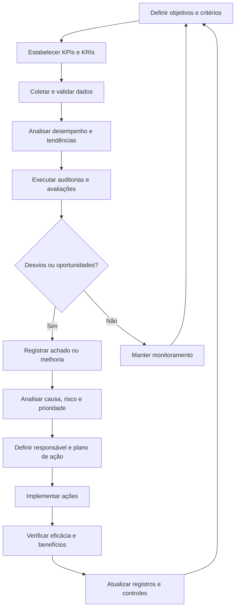

# Gestão de Desempenho, Auditoria e Melhoria Contínua (CSI/PDCA)

## 1. Objetivo

Definir um modelo conceitual para avaliar o desempenho dos processos e serviços de TI, planejar auditorias internas, tratar não conformidades e promover a melhoria contínua do Sistema de Gestão de Serviços (SGS) e do Sistema de Gestão de Segurança da Informação (SGSI).

O processo funciona como mecanismo de supervisão e realimentação da governança, permitindo comparar resultados com objetivos, identificar desvios, avaliar riscos e acompanhar ações corretivas e melhorias.

## 2. Escopo

O modelo proposto contempla:

- Definição e monitoramento de indicadores de desempenho e risco.
- Estabelecimento de linhas de base (baselines) e metas.
- Consolidação de dados em painéis de governança.
- Planejamento e acompanhamento de auditorias internas.
- Registro e tratamento de não conformidades.
- Análise de causas e implementação de ações corretivas.
- Gestão do Registro de Melhoria Contínua (CIR).
- Análises críticas pela direção.
- Acompanhamento dos benefícios das melhorias.
- Aplicação do ciclo PDCA aos processos de governança, serviços e segurança.

A abrangência, os requisitos aplicáveis e a independência das atividades de auditoria devem ser definidos e validados antes da adoção operacional.

## 3. Conceitos fundamentais

### 3.1 Continual Service Improvement (CSI)

A Melhoria Contínua de Serviços busca elevar progressivamente a qualidade, a eficiência e o valor dos serviços, por meio de avaliação sistemática, análise de oportunidades e acompanhamento de resultados.

### 3.2 PDCA

Ciclo de gestão composto por quatro etapas:

- **Plan (Planejar):** estabelecer objetivos, critérios, indicadores e planos de ação.
- **Do (Executar):** implementar os processos, controles e ações planejados.
- **Check (Verificar):** medir resultados, analisar desvios e avaliar a eficácia.
- **Act (Agir):** corrigir problemas, padronizar práticas eficazes e reiniciar o ciclo.

### 3.3 KPI — Key Performance Indicator

Indicador-chave de desempenho utilizado para avaliar a execução de processos e o alcance de objetivos.

### 3.4 KRI — Key Risk Indicator

Indicador-chave de risco utilizado para acompanhar exposições e sinais de aumento da probabilidade ou do impacto de eventos adversos.

### 3.5 Não conformidade

Descumprimento de um requisito aplicável, seja ele normativo, contratual, regulatório ou interno. A classificação e o tratamento devem seguir critérios formalmente estabelecidos.

### 3.6 CAPA — Corrective and Preventive Actions

Conjunto de ações corretivas e preventivas, conforme o modelo adotado, destinadas a tratar não conformidades, suas causas e a possibilidade de recorrência.

### 3.7 CIR — Continual Improvement Register

Registro estruturado de oportunidades de melhoria, contendo justificativa, prioridade, responsável, plano, prazo, benefício esperado e avaliação dos resultados.

## 4. Princípios de governança

O modelo adota os seguintes princípios:

- **Orientação a objetivos:** indicadores e auditorias devem estar relacionados a objetivos de negócio, requisitos e riscos.
- **Confiabilidade dos dados:** as conclusões devem ser sustentadas por dados rastreáveis e critérios consistentes.
- **Rastreabilidade:** decisões, evidências, desvios e ações devem possuir registros adequados.
- **Independência da auditoria:** auditorias devem ser conduzidas com objetividade e tratamento de conflitos de interesse.
- **Proporcionalidade ao risco:** a intensidade do monitoramento e da auditoria deve considerar criticidade e exposição.
- **Responsabilidade definida:** cada desvio ou melhoria deve possuir responsável e prazo.
- **Verificação de eficácia:** encerrar uma ação exige avaliar se o resultado pretendido foi alcançado.
- **Melhoria contínua:** os resultados de medição e auditoria devem alimentar o planejamento seguinte.

## 5. Arquitetura do processo

O processo integra quatro componentes principais:

1. **Medição de desempenho:** define indicadores, fontes, metas e frequências.
2. **Auditoria e avaliação de conformidade:** examina evidências em relação a critérios estabelecidos.
3. **Gestão de desvios:** registra não conformidades, analisa causas e acompanha ações corretivas.
4. **Melhoria contínua:** prioriza oportunidades, acompanha benefícios e realimenta os processos.

O fluxo é conceitual. A organização deve estabelecer seus critérios de auditoria, regras de escalonamento, prazos e autoridades responsáveis.

## 6. Gestão de indicadores

### 6.1 Definição de métricas

Cada indicador deve possuir uma ficha técnica com:

- Nome e identificador.
- Objetivo e dimensão avaliada.
- Fórmula de cálculo.
- Unidade de medida.
- Fonte de dados.
- Frequência de apuração.
- Responsável pela medição.
- Linha de base (baseline).
- Meta ou limite aprovado.
- Critérios de alerta e escalonamento.
- Evidências e histórico de alterações.

### 6.2 Categorias de indicadores

| Categoria | Finalidade | Exemplos |
|---|---|---|
| Desempenho | Medir resultados dos processos | Cumprimento de SLA, disponibilidade |
| Risco | Identificar exposição e tendências adversas | Riscos críticos sem tratamento |
| Conformidade | Verificar atendimento a requisitos | Achados de auditoria em aberto |
| Eficiência | Avaliar uso de recursos | Custo unitário, retrabalho |
| Melhoria | Acompanhar a evolução dos processos | Ações concluídas e benefícios validados |
| Experiência | Medir percepção dos usuários e áreas de negócio | CSAT e satisfação com serviços |

### 6.3 Qualidade dos dados

Antes de utilizar os indicadores em decisões executivas, devem ser avaliados a completude, a consistência, a atualidade e a rastreabilidade das informações.

Alterações de fórmula, fonte ou critério devem ser documentadas para evitar comparações inadequadas entre períodos.

## 7. Painel executivo de governança

O painel de governança deve apresentar uma visão consolidada do desempenho dos processos e serviços, permitindo identificar tendências, exceções e decisões pendentes.

Conteúdo recomendado:

- Indicadores estratégicos e operacionais.
- Resultados em relação às metas aprovadas.
- Evolução histórica.
- Riscos e não conformidades relevantes.
- Situação dos planos de ação.
- Resultados das auditorias.
- Melhorias em andamento.
- Benefícios esperados e realizados.
- Decisões que exigem escalonamento executivo.

A apresentação deve distinguir claramente valores medidos, estimativas, metas propostas e resultados ainda não validados.

## 8. Planejamento de auditoria interna

### 8.1 Planejamento baseado em risco

O programa de auditoria deve considerar:

- Criticidade dos processos e serviços.
- Riscos identificados e histórico de incidentes.
- Alterações relevantes em sistemas, processos ou controles.
- Requisitos contratuais, legais e normativos aplicáveis.
- Resultados de auditorias anteriores.
- Não conformidades recorrentes.
- Mudanças organizacionais e tecnológicas.

A frequência e o escopo das auditorias devem ser definidos segundo os critérios aprovados pela organização.

### 8.2 Etapas da auditoria

1. Definir objetivo, escopo e critérios.
2. Avaliar riscos e selecionar processos ou controles.
3. Planejar atividades, amostragem e recursos.
4. Designar auditores competentes e independentes.
5. Coletar evidências verificáveis.
6. Avaliar evidências em relação aos critérios.
7. Registrar constatações e não conformidades.
8. Comunicar resultados aos responsáveis.
9. Acompanhar as ações corretivas.
10. Verificar a eficácia e encerrar os achados conforme os critérios estabelecidos.

### 8.3 Evidências de auditoria

As evidências devem ser relevantes, suficientes e rastreáveis para sustentar as conclusões.

Exemplos incluem registros de ferramentas ITSM, relatórios de monitoramento, políticas, registros de aprovação, trilhas de auditoria, resultados de testes e documentos de controle.

A existência de um documento ou controle descrito não comprova, isoladamente, sua implementação ou eficácia.

## 9. Gestão de não conformidades e ações corretivas

### 9.1 Registro do achado

Cada não conformidade deve conter:

- Identificador único.
- Data e origem da identificação.
- Processo ou controle afetado.
- Requisito ou critério descumprido.
- Evidência observada.
- Impacto e risco associados.
- Classificação de criticidade.
- Responsável pelo tratamento.
- Prazo acordado.
- Situação e histórico de decisões.

### 9.2 Análise de causa

A análise deve buscar as causas do desvio, e não apenas corrigir o sintoma.

Técnicas possíveis incluem:

- **5 Porquês:** investigação progressiva das causas.
- **Diagrama de Ishikawa:** organização de possíveis fatores causais.
- **Análise de Pareto:** priorização de categorias com maior contribuição para o problema.
- **Análise de causa-raiz:** investigação estruturada das condições que permitiram a ocorrência.

A técnica deve ser escolhida conforme a complexidade, o impacto e a recorrência do problema.

### 9.3 Plano de ação

O plano deve estabelecer:

- Ação imediata de contenção, quando necessária.
- Causa identificada e justificativa.
- Ações corretivas propostas.
- Responsáveis e recursos.
- Prazo e marcos intermediários.
- Evidências esperadas.
- Critérios de sucesso.
- Método e responsável pela verificação de eficácia.

### 9.4 Encerramento

O achado somente deve ser encerrado após avaliação das evidências e cumprimento dos critérios definidos.

Se a ação não eliminar a causa ou se houver recorrência, o caso deve ser reaberto ou submetido a nova análise, conforme o procedimento aprovado.

## 10. Registro de Melhoria Contínua (CIR)

O CIR organiza as oportunidades de evolução e permite acompanhar sua execução e seus benefícios.

### Campos recomendados

| Campo | Descrição |
|---|---|
| Identificador | Código único da oportunidade |
| Origem | Auditoria, indicador, incidente, feedback ou revisão |
| Descrição | Problema, oportunidade ou resultado pretendido |
| Benefício esperado | Resultado operacional, financeiro ou de risco |
| Prioridade | Classificação conforme critérios aprovados |
| Esforço estimado | Recursos e dependências necessários |
| Responsável | Pessoa ou equipe responsável pela condução |
| Prazo | Data ou marco previsto |
| Status | Situação atual da iniciativa |
| Evidência | Registro da implementação e dos resultados |
| Benefício realizado | Resultado efetivamente medido e validado |

### Priorização

As iniciativas podem ser priorizadas considerando valor esperado, risco mitigado, urgência, esforço, custo, dependências e alinhamento estratégico.

Os benefícios devem ser validados com dados apropriados. Estimativas e projeções não devem ser apresentadas como economia ou resultado já realizado.

## 11. Análise crítica pela direção

A análise crítica pela direção deve avaliar se o sistema de gestão continua adequado, eficaz e alinhado às necessidades da organização.

### Entradas recomendadas

- Desempenho dos processos e serviços.
- Cumprimento dos objetivos e metas.
- Resultados de auditorias.
- Situação das não conformidades e ações corretivas.
- Riscos, mudanças e oportunidades.
- Feedback das áreas de negócio e usuários.
- Recursos necessários e restrições.
- Situação das iniciativas de melhoria.
- Mudanças relevantes no contexto organizacional.

### Saídas esperadas

- Decisões sobre prioridades e investimentos.
- Aprovação ou revisão de objetivos.
- Ações para tratar riscos relevantes.
- Definição de responsáveis e prazos.
- Necessidades de recursos ou competências.
- Decisões sobre mudanças no sistema de gestão.

As reuniões devem gerar registros de decisões e encaminhamentos, observando a periodicidade e as alçadas definidas pela organização.

## 12. Indicadores do processo

Os indicadores a seguir são candidatos para avaliação. As metas constantes do documento de referência são propostas para o caso simulado e devem ser validadas antes de qualquer adoção real.

| Indicador | Finalidade |
|---|---|
| Execução do plano de auditoria | Acompanhar auditorias realizadas em relação às planejadas |
| Não conformidades encerradas no prazo | Avaliar pontualidade do tratamento |
| Recorrência de não conformidades | Identificar falhas persistentes ou causas não eliminadas |
| Tempo de tratamento de achados | Avaliar o tempo entre registro e encerramento |
| Eficácia de ações corretivas | Verificar se as causas foram efetivamente tratadas |
| Melhorias com benefícios validados | Medir iniciativas com resultados demonstrados |
| Cumprimento dos objetivos dos processos | Avaliar resultados em relação às metas aprovadas |
| Satisfação das áreas atendidas | Acompanhar percepção de valor e qualidade |
| Ações de melhoria atrasadas | Identificar impedimentos e necessidade de escalonamento |

Cada indicador deve possuir fórmula, frequência, fonte, responsável e critérios de interpretação.

## 13. Papéis e responsabilidades

| Papel | Responsabilidade principal |
|---|---|
| Alta direção / Comitê de governança | Avaliar resultados, deliberar sobre prioridades e aprovar decisões dentro de sua alçada |
| Gestores de processo | Acompanhar indicadores, tratar desvios e conduzir melhorias |
| Responsável por qualidade e métricas | Definir padrões de medição e consolidar informações |
| Auditor interno | Planejar e executar auditorias com objetividade e independência |
| Responsável pelo controle | Disponibilizar evidências e tratar deficiências identificadas |
| Responsável pela ação corretiva | Implementar ações e demonstrar os resultados |
| Gestor do CIR | Manter o registro de melhorias, acompanhar prazos e consolidar benefícios |
| Segurança da informação / GRC | Apoiar avaliações de risco, conformidade e controles sob sua competência |

A estrutura pode variar conforme o porte da organização. A independência entre auditor e responsável pela atividade auditada deve ser preservada conforme os requisitos aplicáveis.

## 14. Integração com os demais processos

Este processo consolida a supervisão dos dez processos previstos no portfólio:

1. Gestão de incidentes.
2. Gestão de problemas e KEDB.
3. Gestão de mudanças e liberações.
4. Gestão de SLM e catálogo de serviços.
5. Gestão de continuidade de TI.
6. Gestão de segurança da informação (SGSI).
7. Gestão de ativos e CMDB.
8. Gestão de fornecedores e BRM.
9. Gestão de demanda, capacidade e FinOps.
10. Gestão de desempenho, auditoria e melhoria contínua.

As informações dos processos devem alimentar indicadores, avaliações de risco, auditorias e oportunidades de melhoria. Os resultados desse processo, por sua vez, devem gerar decisões e ações que retornem aos responsáveis pelos processos.

## 15. Riscos e controles

| Risco | Controle proposto |
|---|---|
| Indicadores sem dados confiáveis | Validar fontes, fórmulas, responsáveis e qualidade dos dados |
| Metas desconectadas dos objetivos | Aprovar metas alinhadas ao negócio e aos riscos |
| Auditoria sem independência suficiente | Avaliar conflitos de interesse e designar auditores adequados |
| Evidências insuficientes | Definir critérios de coleta, rastreabilidade e retenção |
| Não conformidades recorrentes | Analisar causa-raiz e verificar a eficácia das ações |
| Planos de ação atrasados | Acompanhar prazos e escalonar impedimentos |
| Melhorias sem benefício comprovado | Definir baseline e critérios de validação antes da execução |
| Relatórios executivos inconsistentes | Padronizar métricas e validar os dados antes da publicação |
| Ausência de acompanhamento da direção | Estabelecer fóruns, registros e responsabilidades |
| Encerramento prematuro de achados | Exigir evidências e verificação de eficácia |

## 16. Referências técnicas

O modelo conceitual utiliza como referências de trabalho:

- ABNT NBR ISO/IEC 20000-1:2020 — gestão de serviços, avaliação de desempenho e melhoria.
- ABNT NBR ISO/IEC 27001:2022 — avaliação de desempenho e melhoria do SGSI.
- ABNT NBR ISO 19011:2018 — diretrizes para auditoria de sistemas de gestão.
- COBIT 2019 — objetivos de monitoramento, avaliação e análise.
- ITIL 4 — prática de melhoria contínua.
- PDCA — ciclo de planejamento, execução, verificação e ação.

As edições, cláusulas, requisitos e a aplicabilidade devem ser confirmados antes da adoção operacional. A menção a uma referência técnica não representa comprovação de conformidade ou certificação.

## 17. Implantação conceitual

Uma sequência possível de implantação compreende:

1. **Diagnóstico:** mapear processos, indicadores, controles, auditorias e registros existentes.
2. **Definição de governança:** estabelecer escopo, papéis, critérios e alçadas.
3. **Estruturação de indicadores:** definir métricas, baselines, metas e fontes.
4. **Planejamento de auditoria:** estabelecer abordagem baseada em risco e requisitos aplicáveis.
5. **Padronização dos registros:** criar modelos para achados, ações corretivas e CIR.
6. **Implantação de painéis:** consolidar informações de desempenho e risco.
7. **Análise crítica:** estruturar fóruns de avaliação e tomada de decisão.
8. **Verificação de eficácia:** avaliar se as ações produziram os resultados esperados.
9. **Evolução contínua:** revisar critérios, controles e prioridades com base nas evidências.

A sequência é uma proposta de planejamento. Não representa cronograma aprovado, execução concluída ou resultado comprovado.

## 18. Referências e navegação

**Documento de referência do portfólio:**

[Projeto 10 — Desempenho, Auditoria e Melhoria Contínua](../docs/Projeto_10_Desempenho_Auditoria_CSI_PDCA_v1_1_revisado.docx)

**Documentação complementar:**

- [Catálogo de processos](README.md)
- [Biblioteca central de documentos](../docs/README.md)
- [Arquitetura do modelo](../01-arquitetura/README.md)
- [Roadmap de implantação](../02-roadmap/README.md)

## 19. Ressalva sobre o caráter do material

Este documento integra um portfólio conceitual de governança e processos de TI. Os processos, indicadores, metas, controles, auditorias, registros e papéis descritos constituem propostas para estudo e planejamento. Não comprovam execução de auditoria, conformidade normativa, aprovação institucional, certificação ou implantação em uma organização real.
