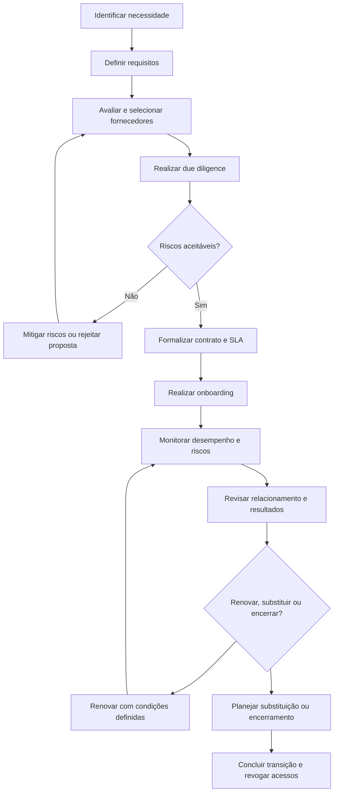

# Gestão de Fornecedores e BRM

## 1. Objetivo

Definir um modelo conceitual de gestão de fornecedores de tecnologia e de Business Relationship Management (BRM), visando alinhar os serviços contratados às necessidades do negócio, controlar riscos, acompanhar níveis de serviço e promover relacionamentos orientados a valor.

O modelo busca estabelecer critérios para seleção, contratação, acompanhamento de desempenho, gestão de riscos, renovação e encerramento de contratos, integrando a gestão de fornecedores à governança de TI.

## 2. Escopo

O processo contempla:

- Identificação e classificação de fornecedores de tecnologia.
- Avaliação de criticidade, dependência e exposição a riscos.
- Due diligence e avaliação prévia.
- Definição de requisitos contratuais e níveis de serviço.
- Monitoramento de desempenho e cumprimento de obrigações.
- Gestão de riscos, não conformidades e planos de ação.
- Relacionamento entre TI, fornecedores e áreas de negócio.
- Gestão de renovações, transições e encerramentos contratuais.
- Registro de informações e evidências para auditoria e tomada de decisão.

## 3. Conceitos fundamentais

### 3.1 Gestão de fornecedores

Disciplina responsável por governar o relacionamento com fornecedores externos, buscando assegurar que as entregas contratadas atendam aos requisitos de qualidade, custo, segurança, continuidade e desempenho.

### 3.2 Business Relationship Management (BRM)

Prática voltada à construção e manutenção do relacionamento entre a área de TI e as áreas de negócio. Seu objetivo é compreender necessidades, alinhar expectativas, facilitar a comunicação e promover a geração de valor por meio dos serviços de tecnologia.

O BRM complementa a gestão de fornecedores, mas não se confunde com ela: enquanto a gestão de fornecedores se concentra na relação contratual e no desempenho externo, o BRM atua no alinhamento entre TI e negócio.

### 3.3 Fornecedor crítico

Fornecedor cuja indisponibilidade, falha ou comprometimento pode produzir impacto relevante sobre operações, dados, segurança, conformidade ou continuidade do negócio.

### 3.4 Acordo de nível de serviço (SLA)

Compromisso formal que estabelece níveis de serviço mensuráveis, responsabilidades, critérios de medição e, quando aplicável, consequências pelo descumprimento.

## 4. Princípios de governança

O modelo proposto adota os seguintes princípios:

- **Segmentação por criticidade:** controles proporcionais ao risco e à relevância do fornecedor.
- **Responsabilidade definida:** cada contrato e relacionamento deve possuir responsáveis identificados.
- **Decisões baseadas em evidências:** avaliações sustentadas por indicadores, registros e entregas verificáveis.
- **Gestão preventiva de riscos:** identificação antecipada de dependências, vulnerabilidades e ameaças.
- **Transparência contratual:** obrigações, SLAs, responsabilidades e critérios de aceite documentados.
- **Alinhamento com o negócio:** decisões de fornecimento conectadas às necessidades e prioridades organizacionais.
- **Melhoria contínua:** avaliações periódicas e planos de ação para corrigir desvios.

## 5. Classificação de fornecedores

A classificação deve considerar, no mínimo, os seguintes fatores:

| Critério | Aspectos avaliados |
|---|---|
| Criticidade operacional | Impacto da falha sobre processos e serviços essenciais |
| Segurança da informação | Acesso a dados, sistemas, credenciais e ambientes corporativos |
| Continuidade | Dependência do fornecedor para manter ou recuperar serviços |
| Conformidade | Obrigações legais, regulatórias e contratuais aplicáveis |
| Dependência tecnológica | Dificuldade de substituição, portabilidade ou migração |
| Impacto financeiro | Custo contratado, exposição financeira e custos de transição |
| Desempenho | Histórico de qualidade, disponibilidade e cumprimento de compromissos |

A classificação final deve seguir critérios formalmente definidos e aprovados pelos responsáveis competentes. As categorias e os limites de criticidade são propostas de desenho e devem ser ajustados à realidade de cada organização.

## 6. Ciclo de vida do fornecedor

O ciclo de vida proposto compreende as seguintes etapas:

1. **Identificação da necessidade:** registrar a demanda, o resultado esperado e a justificativa de contratação.
2. **Avaliação e seleção:** analisar capacidade técnica, custo, reputação, segurança, conformidade e aderência aos requisitos.
3. **Due diligence:** verificar riscos relevantes antes da contratação, conforme a criticidade.
4. **Contratação e formalização:** documentar escopo, responsabilidades, SLA, proteção de dados, segurança, continuidade e condições de saída.
5. **Onboarding:** providenciar acessos autorizados, integração operacional, contatos, procedimentos e requisitos de segurança.
6. **Operação e monitoramento:** acompanhar entregas, indicadores, incidentes, riscos e obrigações contratuais.
7. **Revisão de desempenho:** realizar avaliações periódicas e registrar decisões e planos de melhoria.
8. **Renovação, substituição ou encerramento:** avaliar resultados, riscos, custos e alternativas, assegurando transição controlada.

## 7. Fluxo operacional

O fluxo é ilustrativo. A aplicação real deve contemplar os níveis de aprovação, as alçadas de decisão e os controles internos da organização.

## 8. Due diligence e avaliação de riscos

A avaliação prévia deve ser proporcional à criticidade do fornecedor e ao tipo de serviço contratado.

### Dimensões recomendadas

- Capacidade técnica e operacional.
- Saúde financeira e sustentabilidade do fornecimento.
- Segurança da informação e privacidade.
- Continuidade de negócios e recuperação de desastres.
- Conformidade legal, regulatória e contratual.
- Subcontratação e dependências de terceiros.
- Localização, tratamento e transferência de dados, quando aplicável.
- Estratégia de saída, portabilidade e substituição.

### Tratamento dos riscos

Os riscos identificados devem ser registrados, avaliados e encaminhados para decisão. As respostas possíveis incluem mitigação, transferência contratual quando apropriada, aceitação formal por autoridade competente ou rejeição da contratação.

A aceitação de risco deve observar a política de riscos e as alçadas de aprovação aplicáveis. A existência de cláusula contratual não elimina automaticamente o risco operacional, tecnológico ou de segurança.

## 9. Gestão contratual e SLAs

Os contratos devem refletir os requisitos do serviço e permitir a verificação objetiva das obrigações.

Elementos a considerar:

- Escopo, entregáveis e critérios de aceite.
- Papéis e responsabilidades das partes.
- Indicadores, metas, fontes de dados e frequência de apuração.
- Disponibilidade, tempos de resposta e resolução, quando aplicáveis.
- Comunicação e escalonamento de incidentes.
- Obrigações de segurança e proteção de dados.
- Continuidade, recuperação e testes pertinentes.
- Gestão de mudanças e subcontratados.
- Auditoria, evidências e direito de verificação, quando previsto.
- Regras de reajuste, renovação e encerramento.
- Portabilidade, devolução ou eliminação de dados e revogação de acessos.

Os níveis de serviço e suas metas devem ser definidos conforme a necessidade do negócio e formalizados contratualmente. Não se devem presumir metas universais para todos os fornecedores.

## 10. Monitoramento de desempenho

O monitoramento deve combinar indicadores quantitativos com avaliações qualitativas.

| Dimensão | Evidências ou métricas possíveis |
|---|---|
| Nível de serviço | Cumprimento de SLA e volume de violações |
| Qualidade | Retrabalho, falhas recorrentes e aceite de entregas |
| Prazo | Entregas no prazo e cumprimento de marcos |
| Custo | Variação em relação ao orçamento e custos adicionais |
| Segurança | Incidentes, vulnerabilidades e pendências de controle |
| Risco | Exposições abertas e planos de tratamento vencidos |
| Relacionamento | Satisfação das áreas atendidas e qualidade da comunicação |
| Continuidade | Testes realizados, resultados e pendências identificadas |

Cada indicador deve possuir definição, método de cálculo, fonte de dados, periodicidade, responsável e regra de escalonamento.

## 11. Modelo de relacionamento BRM

O BRM deve funcionar como elo estruturado entre as necessidades do negócio, a capacidade de TI e os serviços prestados internamente ou por fornecedores.

### Práticas propostas

- Mapear as áreas de negócio e seus serviços prioritários.
- Manter registro de necessidades, expectativas e demandas.
- Realizar reuniões periódicas de relacionamento.
- Traduzir necessidades de negócio em requisitos de serviços e resultados esperados.
- Gerenciar expectativas, prioridades e conflitos de demanda.
- Comunicar riscos, limitações, mudanças e resultados.
- Acompanhar satisfação e percepção de valor.
- Promover alinhamento entre indicadores operacionais e objetivos do negócio.

O BRM não deve se limitar à gestão de reclamações. Sua atuação deve favorecer comunicação antecipada, planejamento conjunto e decisões transparentes sobre prioridades.

## 12. Governança, papéis e responsabilidades

A distribuição abaixo é uma referência conceitual. A matriz definitiva deve ser adaptada à estrutura organizacional.

| Papel | Responsabilidade principal |
|---|---|
| Gestor do contrato | Acompanhar obrigações, entregas, riscos e decisões contratuais |
| Responsável técnico | Validar requisitos, qualidade técnica e integração do serviço |
| BRM ou representante de relacionamento | Alinhar expectativas, necessidades e prioridades do negócio |
| Segurança da informação | Avaliar requisitos e riscos de segurança sob sua competência |
| Jurídico e área de contratos | Apoiar cláusulas, obrigações, mudanças e encerramento contratual |
| Suprimentos | Conduzir etapas de aquisição e relacionamento comercial conforme as regras internas |
| Área de negócio demandante | Definir necessidades, validar resultados e avaliar valor entregue |
| Gestão de riscos e compliance | Apoiar avaliações e controles conforme o modelo de governança |
| Comitê ou autoridade competente | Deliberar sobre decisões que excedam as alçadas operacionais |

A mesma pessoa pode exercer mais de um papel em estruturas menores, desde que as responsabilidades e eventuais conflitos de interesse sejam tratados adequadamente.

## 13. Reuniões e fóruns de acompanhamento

A frequência deve ser proporcional à criticidade, ao desempenho e à dinâmica do serviço.

- **Acompanhamento operacional:** tratar incidentes, entregas, pendências e violações de SLA.
- **Revisão periódica do fornecedor:** avaliar indicadores, riscos, conformidade e planos de ação.
- **Reunião de relacionamento BRM:** revisar prioridades, satisfação, necessidades e mudanças no negócio.
- **Revisão executiva:** tratar decisões estratégicas, dependências críticas, custos relevantes e riscos que demandem escalonamento.

Cada reunião deve gerar registro de decisões, responsáveis, prazos e itens pendentes, conforme a necessidade de rastreabilidade.

## 14. Integração com outros processos

A gestão de fornecedores e o BRM devem se integrar a:

- Gestão de serviços e catálogo de serviços.
- Gestão de incidentes e problemas.
- Gestão de mudanças e liberações.
- Gestão de ativos e CMDB.
- Gestão de segurança da informação e riscos.
- Gestão de continuidade de TI.
- Gestão de demanda e capacidade.
- Gestão financeira e controle orçamentário.
- Gestão de contratos, compras e conformidade.
- Gestão de desempenho e melhoria contínua.

Essas integrações evitam que o acompanhamento contratual fique isolado dos impactos efetivos sobre os serviços e o negócio.

## 15. Indicadores de gestão

Indicadores candidatos para avaliação do processo:

| Indicador | Finalidade |
|---|---|
| Cumprimento de SLA | Verificar o atendimento aos níveis de serviço contratados |
| Fornecedores críticos avaliados | Acompanhar a cobertura das avaliações de risco |
| Planos de ação vencidos | Identificar pendências de correção |
| Incidentes associados a fornecedores | Avaliar impactos operacionais atribuíveis ao fornecimento |
| Renovações avaliadas antecipadamente | Reduzir decisões de renovação sem análise suficiente |
| Contratos com responsáveis definidos | Verificar a clareza de accountability |
| Satisfação das áreas atendidas | Avaliar a percepção dos usuários e das áreas de negócio |
| Riscos críticos sem tratamento aprovado | Evidenciar exposições que exigem decisão |
| Entregas aceitas no prazo | Acompanhar qualidade e previsibilidade das entregas |

Os indicadores são sugestões de desenho. Metas, limites, frequência e responsabilidades devem ser definidos e aprovados antes de serem usados como critérios formais de desempenho.

## 16. Riscos e controles

| Risco | Controle proposto |
|---|---|
| Dependência excessiva de um fornecedor | Avaliar concentração, alternativas e estratégia de saída |
| Contrato sem métricas verificáveis | Definir SLA, fontes de dados e critérios de aceite |
| Acesso indevido de terceiros | Aplicar autorização, menor privilégio, revisão e revogação de acessos |
| Riscos de segurança não avaliados | Realizar due diligence proporcional à criticidade |
| Renovação sem avaliação de desempenho | Estabelecer revisão prévia de resultados, custos e riscos |
| Descumprimento contratual recorrente | Registrar ocorrências, escalar e acompanhar plano de ação |
| Falha na transição de fornecedor | Planejar transferência de conhecimento, dados, ativos e responsabilidades |
| Desalinhamento entre TI e negócio | Formalizar fóruns BRM, prioridades e decisões |

## 17. Implantação conceitual

Uma implantação futura pode ser organizada em etapas:

1. **Diagnóstico:** mapear fornecedores, contratos, serviços, responsáveis e controles existentes.
2. **Segmentação:** classificar fornecedores e definir os critérios de criticidade.
3. **Padronização:** estabelecer modelos de avaliação, cadastro, acompanhamento e encerramento.
4. **Governança:** definir papéis, alçadas, fóruns e regras de escalonamento.
5. **Indicadores:** estabelecer métricas, fontes de dados e periodicidade.
6. **Piloto:** aplicar o modelo a um conjunto controlado de fornecedores.
7. **Avaliação e evolução:** revisar resultados, corrigir lacunas e ampliar gradualmente o escopo.

A sequência é uma proposta de implementação, não um cronograma aprovado ou evidência de execução real.

## 18. Referências e navegação

**Documento de referência do portfólio:**

[Projeto 08 — Gestão de Fornecedores e BRM](../docs/Projeto_08_Gestao_Fornecedores_BRM_v1_1_revisado.docx)

**Documentação complementar:**

- [Catálogo de processos](README.md)
- [Biblioteca central de documentos](../docs/README.md)
- [Arquitetura do modelo](../01-arquitetura/README.md)
- [Roadmap de implantação](../02-roadmap/README.md)

## 19. Ressalva sobre o caráter do material

Este documento integra um portfólio conceitual de governança e processos de TI. O fluxo, os papéis, os controles, os indicadores e as etapas de implantação são propostas para estudo e discussão. Não representam, por si só, comprovação de implantação, auditoria, aprovação institucional ou certificação em uma organização real.
