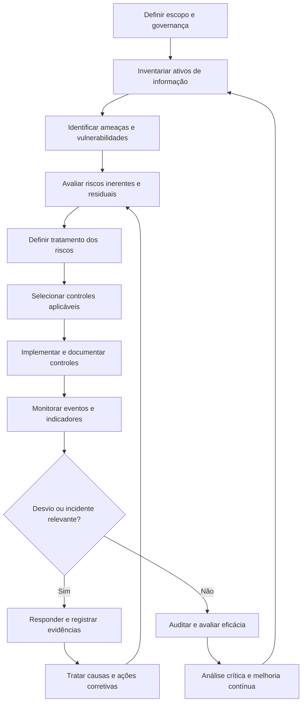

# Gestão da Segurança da Informação (SGSI/ISO 27001)

## 1. Objetivo

Estabelecer um modelo conceitual para estruturar um Sistema de Gestão de Segurança da Informação (SGSI), integrando governança, gestão de riscos, controles de segurança, monitoramento, resposta a incidentes, conformidade e melhoria contínua.

O modelo tem como finalidade preservar a confidencialidade, a integridade e a disponibilidade das informações, apoiando a proteção dos ativos, a continuidade dos serviços e o cumprimento dos requisitos legais, regulatórios e contratuais aplicáveis.

O desenho utiliza como referências de trabalho a ISO/IEC 27001:2022, a ISO/IEC 27002:2022, a ISO/IEC 27005, a ISO/IEC 27557 e o CIS Controls v8.1, além de considerar requisitos de proteção de dados pessoais e controles relacionados à conformidade corporativa.

> **Natureza do documento:** projeto autoral e conceitual para portfólio profissional. Os riscos, controles, papéis, metas e procedimentos são propostas de referência. Não comprovam implantação, aprovação corporativa, auditoria ou certificação real.

## 2. Escopo do SGSI

O escopo deve ser definido e aprovado formalmente pela organização, considerando seu contexto, os requisitos aplicáveis e as interfaces internas e externas.

O modelo de referência considera, conforme aplicabilidade:

- Infraestrutura local e ambientes de data center.
- Serviços e plataformas de computação em nuvem.
- Redes corporativas, endpoints e dispositivos móveis.
- Bancos de dados, aplicações, APIs e serviços SaaS.
- Informações corporativas e dados pessoais.
- Colaboradores, prestadores de serviços e terceiros com acesso aos ativos.
- Fornecedores tecnológicos e demais dependências relevantes.

A delimitação definitiva deve identificar unidades, processos, ativos, interfaces, exclusões justificadas e controles compensatórios necessários.

## 3. Princípios fundamentais

A estrutura do SGSI considera os seguintes princípios:

- **Confidencialidade:** restringir o acesso às informações às pessoas, sistemas e entidades autorizadas.
- **Integridade:** preservar a exatidão, a completude e a confiabilidade das informações.
- **Disponibilidade:** assegurar acesso às informações e aos serviços quando necessário e autorizado.
- **Gestão baseada em riscos:** priorizar ações conforme riscos identificados, impactos e critérios de aceitação definidos.
- **Responsabilidade definida:** atribuir papéis, autoridades e responsabilidades pelos ativos, riscos e controles.
- **Evidência e rastreabilidade:** manter registros que permitam demonstrar decisões, execução e acompanhamento.
- **Melhoria contínua:** avaliar resultados, tratar desvios e atualizar controles e planos conforme necessário.

## 4. Referências e estrutura de controles

O modelo utiliza como referências principais:

| Referência | Aplicação conceitual |
|---|---|
| ISO/IEC 27001:2022 | Requisitos para estabelecer, operar, avaliar e melhorar um SGSI. |
| ISO/IEC 27002:2022 | Orientações para seleção e implementação de controles de segurança da informação. |
| ISO/IEC 27005 | Orientações para gestão de riscos de segurança da informação. |
| ISO/IEC 27557 | Referência complementar para riscos relacionados à organização, conforme aplicabilidade. |
| CIS Controls v8.1 | Referência complementar para priorização de práticas e controles de cibersegurança. |
| LGPD | Consideração dos requisitos aplicáveis ao tratamento e à proteção de dados pessoais. |
| SOX / ITGC | Consideração de controles gerais de TI quando houver obrigação ou necessidade aplicável ao contexto corporativo. |

A aplicabilidade de normas, controles e obrigações deve ser validada conforme o contexto da organização. A simples referência a uma norma não comprova conformidade.

## 5. Ciclo operacional do SGSI

O processo é organizado segundo o ciclo de melhoria contínua PDCA (*Plan–Do–Check–Act*).

| Fase | Atividades propostas | Resultados esperados |
|---|---|---|
| **Plan — Planejar** | Definir escopo, política, critérios de risco, avaliação de riscos e plano de tratamento. | Escopo documentado, critérios de avaliação, matriz de riscos e plano de tratamento. |
| **Do — Executar** | Implementar controles selecionados, atribuir responsabilidades, capacitar pessoas e operar os mecanismos de segurança. | Controles implementados conforme planejamento e registros de execução. |
| **Check — Verificar** | Monitorar indicadores, avaliar controles, realizar auditorias internas e analisar resultados. | Evidências, resultados de monitoramento e identificação de desvios. |
| **Act — Agir** | Tratar não conformidades, executar ações corretivas e revisar riscos, controles e prioridades. | Planos de melhoria, riscos atualizados e controles aperfeiçoados. |

O ciclo deve ser contínuo. Alterações relevantes no ambiente, nos riscos ou nos requisitos podem exigir revisão antecipada do escopo, dos controles e dos planos.

## 6. Fluxo conceitual de gestão da segurança

O fluxo representa uma proposta de organização do processo. As etapas, alçadas e procedimentos específicos devem ser definidos e aprovados conforme a realidade organizacional.

## 7. Gestão de riscos de segurança da informação

A avaliação de riscos deve identificar os ativos relevantes, as ameaças, as vulnerabilidades, os impactos potenciais e a eficácia dos controles existentes.

### Etapas propostas

1. Identificar o ativo de informação e seu responsável (*Asset Owner*).
2. Identificar ameaças, vulnerabilidades e cenários de risco.
3. Avaliar impactos sobre confidencialidade, integridade e disponibilidade.
4. Estimar a probabilidade ou plausibilidade de ocorrência segundo critérios definidos.
5. Determinar o risco inerente.
6. Avaliar os controles existentes e sua eficácia.
7. Determinar o risco residual.
8. Definir a opção de tratamento: mitigar, evitar, transferir ou aceitar, conforme aplicabilidade.
9. Elaborar o Plano de Tratamento de Riscos.
10. Registrar decisões, responsáveis, prazos e aprovações necessárias.

A metodologia, as escalas de avaliação, os critérios de criticidade e as alçadas para aceitação de riscos devem ser formalmente definidos. Não se deve considerar uma pontuação hipotética como regra corporativa aprovada.

## 8. Plano de tratamento de riscos e Declaração de Aplicabilidade

O tratamento de riscos deve documentar as ações escolhidas para modificar os riscos identificados e acompanhar sua execução.

A documentação de referência contempla dois artefatos importantes:

- **Plano de Tratamento de Riscos (RTP):** registra as ações de tratamento, responsáveis, prazos, dependências e critérios de acompanhamento.
- **Declaração de Aplicabilidade (SoA — Statement of Applicability):** documenta os controles aplicáveis, as justificativas de inclusão ou exclusão e o respectivo estado de implementação, conforme os requisitos aplicáveis da ISO/IEC 27001.

A SoA não deve ser preenchida como se todos os controles estivessem implementados. A aplicabilidade e o estado de cada controle precisam ser avaliados com base no escopo, nos riscos e nas evidências disponíveis.

## 9. Domínios de controle

O modelo utiliza os quatro temas de controles da ISO/IEC 27002:2022 como estrutura de referência.

| Tema | Exemplos de assuntos abrangidos |
|---|---|
| Organizacionais | Políticas, responsabilidades, gestão de riscos, fornecedores, incidentes e continuidade. |
| Pessoas | Conscientização, competências, responsabilidades e compromissos de segurança. |
| Físicos | Proteção de instalações, áreas, equipamentos e ativos físicos. |
| Tecnológicos | Controle de acesso, autenticação, proteção contra malware, vulnerabilidades, criptografia e monitoramento. |

A seleção de controles deve ser orientada pela avaliação de riscos e pelos requisitos aplicáveis. A existência de um controle documentado não comprova sua implementação ou eficácia.

## 10. Controles e procedimentos operacionais prioritários

O documento de referência organiza procedimentos operacionais em cinco grupos principais.

| Procedimento | Objetivo conceitual |
|---|---|
| Avaliação de riscos e tratamento | Identificar, avaliar e tratar sistematicamente os riscos de segurança da informação. |
| Incidentes cibernéticos e notificações | Detectar, conter, investigar, erradicar e recuperar-se de incidentes, avaliando obrigações de comunicação aplicáveis. |
| Gestão de acessos, identidades e privilégios (IAM/PAM) | Controlar concessões, revisões, revogações e acessos privilegiados. |
| Vulnerabilidades, correções e testes | Identificar vulnerabilidades, priorizar correções e avaliar a eficácia dos controles técnicos. |
| Segurança de terceiros | Avaliar riscos de segurança e privacidade associados a fornecedores e serviços externos. |

Cada procedimento operacional deverá especificar, conforme o risco e a necessidade:

- Identificador, objetivo e escopo.
- Responsáveis pela execução, aprovação e consulta.
- Pré-requisitos e informações de entrada.
- Ferramentas e recursos necessários.
- Etapas de execução e verificações.
- Regras de negócio, exceções e escalonamentos.
- Registros e evidências exigidos.
- Indicadores e critérios de qualidade.
- Interfaces com outros processos.
- Tratamento de falhas e revisão do procedimento.

## 11. Gestão de identidades, acessos e privilégios

O modelo considera o controle de identidades e privilégios como parte relevante da redução de riscos de acesso indevido.

As práticas a avaliar incluem:

- Concessão de acesso com base em necessidade de negócio e menor privilégio.
- Autenticação multifator conforme os riscos e os requisitos aplicáveis.
- Segregação de funções.
- Revisão periódica de acessos e privilégios.
- Revogação de acessos após desligamentos ou alterações de vínculo.
- Gestão controlada de contas administrativas por mecanismos IAM/PAM.
- Registro e monitoramento de atividades privilegiadas.
- Processo formal de exceções, com justificativa, aprovação, prazo e revisão.

Os prazos, tecnologias e critérios de obrigatoriedade devem ser definidos e validados no contexto organizacional, sem assumir que metas propostas já constituem política aprovada.

## 12. Monitoramento e resposta a incidentes cibernéticos

O processo deve prever mecanismos para identificar eventos relevantes, avaliar alertas, responder a incidentes e preservar evidências.

As etapas conceituais incluem:

1. Detectar ou receber a comunicação de um evento.
2. Realizar triagem e avaliar se existe incidente de segurança.
3. Classificar a gravidade e determinar o escalonamento.
4. Conter o incidente e reduzir os impactos.
5. Preservar registros e evidências conforme procedimentos aplicáveis.
6. Investigar e erradicar a causa ou ameaça.
7. Recuperar os serviços de forma segura.
8. Avaliar impactos sobre dados pessoais e outras obrigações.
9. Realizar comunicações internas e externas quando aplicáveis.
10. Documentar resultados e ações corretivas.

SIEM, SOAR, EDR/XDR e equipes SOC/CSIRT são exemplos de componentes e funções que podem apoiar esse modelo. Sua necessidade, abrangência e disponibilidade dependem do contexto, do risco e dos recursos existentes.

Os prazos de comunicação regulatória devem ser confirmados segundo a legislação vigente e as circunstâncias do incidente. Este documento não substitui avaliação jurídica ou regulatória.

## 13. Segurança de terceiros e fornecedores

A avaliação de terceiros deve considerar os riscos introduzidos por fornecedores que processam informações, hospedam sistemas, fornecem serviços tecnológicos ou possuem acesso a ativos da organização.

O processo pode contemplar:

- Classificação de fornecedores por criticidade e exposição.
- Avaliação de requisitos de segurança e privacidade antes da contratação, quando aplicável.
- Análise de controles e evidências fornecidas pelo terceiro.
- Definição de responsabilidades e obrigações contratuais.
- Avaliação de acesso a informações e ambientes.
- Monitoramento e reavaliação durante o relacionamento.
- Tratamento de riscos, exceções e não conformidades.
- Planejamento de encerramento do contrato e revogação de acessos.

A profundidade da avaliação deve ser proporcional ao risco e às informações tratadas. Declarações de fornecedores não devem ser consideradas, isoladamente, prova suficiente da eficácia de todos os controles.

## 14. Papéis e responsabilidades

O modelo de referência contempla papéis que podem ser adaptados à estrutura da organização.

| Papel | Responsabilidade proposta |
|---|---|
| CISO ou responsável pela segurança | Coordenar a governança de segurança, os riscos e a evolução do SGSI, conforme autoridade formalmente definida. |
| Comitê de Segurança | Apoiar decisões, priorização, análise de riscos e acompanhamento de ações relevantes. |
| SOC/CSIRT | Apoiar monitoramento, detecção, investigação e resposta a incidentes, conforme o modelo operacional adotado. |
| Equipes de Infraestrutura/DevOps | Implementar e manter controles técnicos, configurações seguras e correções sob sua responsabilidade. |
| Responsáveis pelos ativos | Conhecer os ativos sob sua responsabilidade e participar da avaliação e do tratamento de riscos. |
| DPO/Encarregado | Participar das avaliações e comunicações relacionadas a dados pessoais dentro das atribuições aplicáveis. |
| Jurídico e Compliance | Apoiar a interpretação de obrigações legais, regulatórias e contratuais. |
| Usuários e gestores | Cumprir as políticas aplicáveis e reportar eventos suspeitos pelos canais definidos. |
| Auditoria interna | Avaliar controles e evidências com independência adequada, conforme seu mandato. |

A distribuição de responsabilidades deve ser formalizada em uma matriz RACI ou instrumento equivalente. A independência das atividades de avaliação e auditoria deve ser considerada no desenho da governança.

## 15. Indicadores sugeridos

O documento de referência propõe indicadores de detecção e resposta a incidentes, correção de vulnerabilidades e conscientização. A seleção definitiva deve refletir o contexto e a capacidade operacional.

| Indicador | Finalidade |
|---|---|
| MTTD — Mean Time to Detect | Medir o tempo médio para detectar incidentes ou ameaças, conforme regra de cálculo definida. |
| MTTR — Mean Time to Respond/Recover | Medir o tempo médio de resposta ou recuperação, especificando claramente qual evento encerra a medição. |
| Conformidade de correção de vulnerabilidades | Acompanhar a proporção de vulnerabilidades corrigidas dentro dos prazos definidos por criticidade. |
| Cobertura de capacitação em segurança | Acompanhar a participação no treinamento de conscientização previsto. |
| Taxa de clique em simulações de phishing | Avaliar tendências de comportamento em campanhas de simulação, interpretadas com contexto. |
| Riscos com tratamento em andamento ou vencido | Monitorar o andamento das ações de tratamento de riscos. |
| Controles avaliados com evidências disponíveis | Acompanhar a cobertura de avaliação e documentação dos controles selecionados. |
| Ações corretivas pendentes | Identificar desvios de segurança que permanecem sem tratamento concluído. |
| Avaliações de terceiros realizadas | Acompanhar a cobertura de avaliação de fornecedores segundo critérios de criticidade. |

O documento de referência apresenta valores quantitativos propostos para alguns indicadores, mas eles não devem ser tratados como metas aprovadas ou resultados reais. Antes da adoção, cada indicador precisa de fórmula, fonte, periodicidade, responsável, linha de base e meta justificada.

## 16. Auditoria, análise crítica e melhoria contínua

A avaliação do SGSI deve verificar se os controles selecionados estão definidos, implementados conforme planejado e produzindo os resultados esperados.

O ciclo de avaliação pode incluir:

- Monitoramento de indicadores e tendências.
- Avaliação periódica de riscos.
- Verificação de evidências de execução dos controles.
- Auditorias internas com escopo e critérios definidos.
- Análise de não conformidades e causas.
- Acompanhamento de ações corretivas.
- Análise crítica pela direção.
- Revisão de políticas, procedimentos, recursos e prioridades.
- Atualização do plano de tratamento de riscos e da SoA quando aplicável.

A documentação de evidências deve ser consistente, protegida e rastreável. A realização de uma auditoria interna, por si só, não representa certificação independente.

## 17. Documentos e registros de apoio

O modelo prevê a utilização de artefatos de gestão para apoiar a rastreabilidade e a tomada de decisão.

| Artefato | Finalidade |
|---|---|
| Política de Segurança da Informação | Formalizar diretrizes, responsabilidades e princípios após revisão e aprovação apropriadas. |
| Inventário de ativos e responsáveis | Identificar ativos de informação e seus responsáveis. |
| Matriz de riscos | Documentar cenários, avaliações, tratamentos e riscos residuais. |
| Plano de Tratamento de Riscos | Acompanhar ações, responsáveis, prazos e resultados. |
| Declaração de Aplicabilidade (SoA) | Documentar a aplicabilidade e o estado dos controles no escopo do SGSI. |
| Registros de incidentes | Manter histórico, decisões, ações e evidências relevantes. |
| Avaliações de terceiros | Registrar análises de risco e decisões relacionadas a fornecedores. |
| Relatórios de vulnerabilidades | Apoiar priorização, correção e verificação de vulnerabilidades. |
| Registros de treinamento | Acompanhar atividades de conscientização e capacitação. |
| Relatórios de auditoria e ações corretivas | Documentar achados, decisões e acompanhamento de melhorias. |

A política, a SoA e os demais documentos normativos devem permanecer identificados como minutas ou propostas até que sejam formalmente avaliados e aprovados pela autoridade competente.

## 18. Riscos e pontos de atenção

- Definir um escopo sem identificar adequadamente ativos e dependências.
- Tratar hipóteses de diagnóstico como constatações verificadas.
- Selecionar controles sem justificativa baseada em riscos e requisitos aplicáveis.
- Aceitar riscos sem autoridade ou documentação adequada.
- Manter acessos privilegiados sem revisão e controle suficientes.
- Não corrigir vulnerabilidades conforme criticidade e risco.
- Deixar de preservar evidências durante incidentes.
- Avaliar fornecedores sem considerar a exposição de dados e serviços.
- Utilizar metas sem linha de base ou sem capacidade operacional demonstrada.
- Manter documentos e registros desatualizados.
- Confundir documentação de controles com evidência de eficácia.
- Declarar conformidade ou certificação sem avaliação apropriada e evidências suficientes.

## 19. Implantação conceitual

O documento de referência apresenta uma proposta de implantação inicial em 90 dias, organizada em quatro fases indicativas. A viabilidade depende do diagnóstico, do escopo, dos recursos, das dependências e da maturidade da organização.

| Fase indicativa | Foco proposto |
|---|---|
| Dias 1–30 | Avaliação de lacunas, inventário de ativos, avaliação de riscos e elaboração da política para revisão. |
| Dias 31–60 | Planejamento e implantação priorizada de controles técnicos e mecanismos de monitoramento, conforme risco e capacidade. |
| Dias 61–75 | Conscientização, avaliação de terceiros e atividades complementares de tratamento de riscos. |
| Dias 76–90 | Avaliação interna, exercícios de validação e análise crítica dos resultados, conforme prontidão. |

Este cronograma é uma estimativa de referência do case, não um compromisso de execução. A evolução e a maturação do SGSI podem exigir um horizonte mais longo, com priorização baseada em risco e recursos efetivamente disponíveis.

## 20. Documento de referência

Esta página apresenta a síntese navegável do processo para o portfólio. Para consultar a documentação de referência completa, acesse:

[Projeto 06 — Gestão da Segurança da Informação (SGSI/ISO 27001)](../docs/Projeto_06_SGSI_ISO27001_v1_1_revisado.docx)

Para visualizar os demais processos, consulte o [catálogo de processos](README.md) e o [índice da documentação central](../docs/README.md).

---

*Documento conceitual para portfólio profissional. Não constitui evidência de implantação, operação, auditoria ou certificação de uma organização real.*
