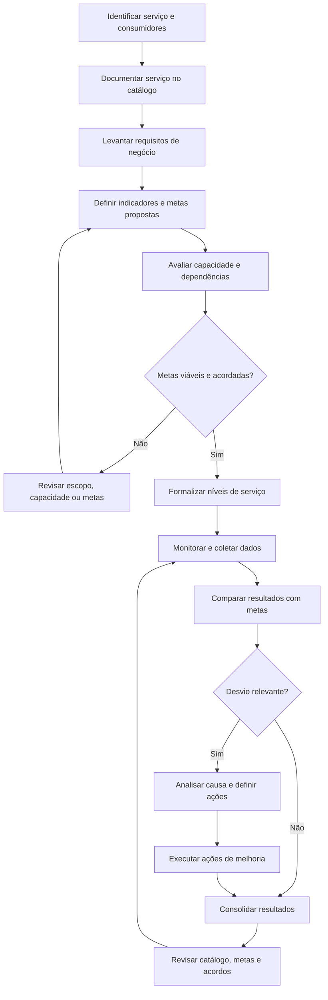

# Gestão de Nível de Serviço (SLM) e Catálogo de Serviços

## 1. Objetivo

Estabelecer um modelo conceitual para organizar o catálogo de serviços de TI, definir expectativas de qualidade e estabelecer mecanismos de acompanhamento dos níveis de serviço acordados com as áreas de negócio e demais partes interessadas.

O processo busca aumentar a transparência sobre os serviços oferecidos, suas responsabilidades, condições de atendimento, dependências e indicadores de desempenho, promovendo alinhamento entre a capacidade operacional de TI e as necessidades do negócio.

Este processo integra o programa conceitual de Sistema de Gestão de Serviços (SGS) e Sistema de Gestão de Segurança da Informação (SGSI).

> **Natureza do documento:** material conceitual desenvolvido para demonstração de conhecimento técnico e capacidade de estruturação de processos. Não representa uma implementação real, nem comprova a adoção deste processo por uma organização.

## 2. Escopo

O processo contempla:

- Estruturação e manutenção do catálogo de serviços de TI.
- Identificação dos responsáveis pelos serviços e das áreas consumidoras.
- Definição de requisitos e níveis de serviço.
- Estabelecimento de indicadores e mecanismos de medição.
- Monitoramento de desempenho e análise de desvios.
- Comunicação de resultados e tratamento de oportunidades de melhoria.
- Integração com incidentes, mudanças, capacidade, continuidade e fornecedores.

O conteúdo do catálogo, os níveis de serviço e as métricas devem ser definidos de acordo com o contexto organizacional, a criticidade dos serviços e a capacidade efetivamente disponível.

## 3. Conceitos fundamentais

| Conceito | Definição operacional proposta |
|---|---|
| Catálogo de serviços | Visão estruturada dos serviços de TI disponibilizados aos usuários e às áreas de negócio, com informações sobre escopo, responsáveis e condições de atendimento. |
| Gestão de Nível de Serviço (SLM) | Processo de definição, acompanhamento, avaliação e melhoria dos níveis de serviço. |
| Acordo de Nível de Serviço (SLA) | Acordo documentado que estabelece compromissos de serviço entre o provedor e o cliente ou a área consumidora. |
| Acordo de Nível Operacional (OLA) | Acordo interno entre equipes ou unidades que contribuem para a entrega de um serviço. |
| Contrato de Apoio (UC) | Compromisso contratual com fornecedor que contribui para a entrega de um serviço. |
| Indicador de serviço | Medida utilizada para avaliar desempenho, qualidade, disponibilidade ou outro atributo relevante do serviço. |
| Meta de serviço | Valor ou critério de desempenho definido para avaliar se o serviço atende às expectativas acordadas. |

SLA, OLA e contratos de apoio devem ser coerentes entre si. Um compromisso assumido com o cliente precisa considerar as dependências internas e externas necessárias para sua entrega.

## 4. Estrutura recomendada do catálogo

O catálogo deve apresentar informações úteis para consumidores, gestores e equipes técnicas. Conforme o modelo adotado, pode ser organizado em uma visão voltada ao usuário e outra com informações técnicas e operacionais.

| Campo | Finalidade |
|---|---|
| Identificador e nome do serviço | Permitir identificação única e comunicação consistente. |
| Descrição e objetivo | Explicar o serviço e o valor entregue. |
| Área responsável | Identificar o responsável pelo serviço. |
| Público consumidor | Indicar usuários, áreas ou grupos atendidos. |
| Horário de atendimento | Informar a cobertura de suporte aplicável. |
| Critérios de solicitação | Descrever canais, requisitos e condições de acesso. |
| Criticidade do serviço | Registrar a relevância do serviço para as operações do negócio. |
| Níveis de serviço | Referenciar metas e compromissos formalmente definidos. |
| Dependências | Identificar serviços, sistemas, infraestrutura e fornecedores relacionados. |
| Indicadores | Indicar como o desempenho e a qualidade serão avaliados. |
| Continuidade e suporte | Referenciar condições de contingência, recuperação e escalonamento quando aplicáveis. |
| Estado do serviço | Indicar se está em planejamento, ativo, em revisão ou descontinuado. |

O catálogo deve ser mantido atualizado. Informações incompletas, duplicadas ou desatualizadas podem gerar expectativas incorretas e dificultar a gestão operacional.

## 5. Fluxo conceitual do processo

Este fluxo é uma referência conceitual. As responsabilidades pela aprovação dos níveis de serviço e pela validação da capacidade devem ser formalmente definidas pela organização.

## 6. Definição de níveis de serviço

Os níveis de serviço devem refletir necessidades de negócio, criticidade, risco, capacidade operacional e custos associados.

A definição pode considerar:

- Horários de disponibilidade e cobertura de atendimento.
- Disponibilidade do serviço.
- Tempo de resposta e de restauração, quando aplicáveis.
- Prazo de atendimento de solicitações.
- Desempenho e capacidade.
- Qualidade percebida pelos usuários.
- Requisitos de segurança e continuidade.
- Dependências internas e compromissos de fornecedores.

É importante distinguir métricas que frequentemente são confundidas:

- **Tempo de resposta:** intervalo entre a entrada de uma demanda e a primeira resposta conforme o critério definido.
- **Tempo de resolução:** intervalo até a solução ou conclusão do atendimento, conforme a regra estabelecida.
- **Tempo de restauração:** intervalo até o restabelecimento do serviço após uma interrupção.
- **Disponibilidade:** proporção do período de referência em que o serviço atende aos critérios definidos para ser considerado disponível.

Cada compromisso deve estabelecer a fórmula, o período de apuração, as exclusões aplicáveis, a fonte de dados e as regras para tratamento de exceções. Nenhuma meta deve ser prometida sem avaliação de viabilidade e alinhamento com as partes interessadas.

## 7. Monitoramento e análise de desempenho

O acompanhamento deve transformar dados operacionais em informação útil para a tomada de decisão.

Etapas recomendadas:

1. Coletar dados a partir de fontes identificadas e confiáveis.
2. Verificar qualidade, completude e consistência dos dados.
3. Calcular os indicadores segundo fórmulas documentadas.
4. Comparar resultados com metas e períodos anteriores.
5. Identificar desvios, tendências e serviços mais impactados.
6. Analisar causas e dependências relevantes.
7. Definir ações corretivas ou preventivas com responsáveis e prazos.
8. Acompanhar a eficácia das ações.
9. Comunicar resultados às partes interessadas.
10. Revisar metas, acordos e catálogo quando houver justificativa.

A frequência de medição e reporte deve ser compatível com a criticidade dos serviços e com as necessidades de governança.

## 8. Papéis e responsabilidades

| Papel | Responsabilidade proposta |
|---|---|
| Gestor do serviço | Responder pela visão integrada do serviço, suas necessidades, dependências e resultados. |
| Gestor de SLM | Coordenar a definição, o acompanhamento e a revisão dos níveis de serviço. |
| Responsável pelo catálogo | Manter as informações dos serviços completas, consistentes e atualizadas. |
| Equipes técnicas | Fornecer dados operacionais, tratar desvios e executar ações sob sua responsabilidade. |
| Áreas de negócio | Comunicar necessidades, prioridades e expectativas sobre os serviços. |
| Gestão de fornecedores | Acompanhar compromissos externos que influenciam a entrega do serviço. |
| Gestão de Incidentes | Fornecer dados sobre falhas, impacto, atendimento e restauração. |
| Governança de TI | Acompanhar resultados relevantes, riscos, prioridades e decisões de melhoria. |

Os papéis podem ser acumulados ou distribuídos de forma diferente conforme o porte e a estrutura da organização.

## 9. Integração com outros processos

| Processo relacionado | Integração proposta |
|---|---|
| Gestão de Incidentes | Fornecer dados sobre interrupções, atendimento, impacto e restauração. |
| Gestão de Problemas e KEDB | Apoiar a análise de causas de desvios recorrentes e a definição de melhorias. |
| Gestão de Mudanças e Liberações | Avaliar impactos de alterações sobre os níveis de serviço. |
| Gestão de Ativos e CMDB | Relacionar serviços aos componentes e dependências relevantes, quando houver dados confiáveis. |
| Gestão de Continuidade de TI | Integrar requisitos de continuidade, recuperação e tolerância à interrupção. |
| Gestão de Capacidade e Demanda | Avaliar se os recursos disponíveis suportam as metas de serviço. |
| Gestão de Fornecedores | Alinhar contratos e compromissos externos aos níveis de serviço oferecidos. |
| Indicadores e Melhoria Contínua | Consolidar resultados, analisar tendências e acompanhar ações de melhoria. |

## 10. Indicadores sugeridos

| Indicador | Finalidade |
|---|---|
| Disponibilidade por serviço | Avaliar a proporção do período em que cada serviço atendeu aos critérios de disponibilidade. |
| Cumprimento dos SLAs | Medir a proporção de resultados que atenderam aos compromissos acordados. |
| Tempo de resposta | Acompanhar a agilidade da primeira resposta conforme definição formal. |
| Tempo de restauração | Avaliar a rapidez de restabelecimento após interrupções. |
| Cumprimento de prazos de solicitações | Avaliar o atendimento dos prazos definidos para solicitações de serviço. |
| Satisfação dos usuários | Acompanhar a percepção dos consumidores sobre a qualidade do serviço. |
| Catálogo atualizado | Avaliar a proporção de registros revisados conforme os critérios de atualização definidos. |
| Desvios recorrentes de serviço | Identificar serviços com falhas de desempenho repetidas. |
| Ações de melhoria concluídas | Acompanhar a execução das ações estabelecidas após análises de desempenho. |

Cada indicador deve ter fórmula, fonte, periodicidade, responsável e critérios de interpretação definidos. Resultados e metas reais somente poderão ser estabelecidos a partir de dados e compromissos efetivamente definidos.

## 11. Riscos e pontos de atenção

- Definir metas sem compreender as necessidades do negócio.
- Prometer níveis de serviço incompatíveis com a capacidade disponível.
- Manter informações desatualizadas no catálogo.
- Utilizar fontes de dados incompletas ou inconsistentes.
- Confundir tempo de resposta, resolução e restauração.
- Não considerar dependências de fornecedores e equipes internas.
- Monitorar indicadores sem definir responsáveis por desvios.
- Tratar o cumprimento do SLA como único critério de qualidade.
- Não revisar compromissos após mudanças relevantes no serviço ou no contexto operacional.

## 12. Implantação conceitual

Uma implantação real deverá considerar o catálogo existente, a maturidade dos serviços, as ferramentas de medição, as expectativas do negócio e os compromissos contratuais.

Como sequência inicial de trabalho, propõe-se:

1. Inventariar os serviços existentes e identificar seus responsáveis.
2. Definir a estrutura do catálogo e os campos obrigatórios.
3. Levantar requisitos e expectativas das áreas consumidoras.
4. Avaliar capacidade, riscos, dependências e dados disponíveis.
5. Propor indicadores, metas e regras de medição.
6. Formalizar os níveis de serviço com as partes interessadas.
7. Estabelecer rotina de monitoramento, reporte e tratamento de desvios.
8. Revisar periodicamente catálogo, metas e ações de melhoria.

A duração e a sequência dependem do contexto organizacional, da maturidade dos serviços e da qualidade das informações disponíveis.

## 13. Documento de referência

Este arquivo é a síntese navegável do processo no portfólio. Para consultar a documentação de referência mais completa, acesse:

[Projeto 04 — Gestão de SLM e Catálogo](../docs/Projeto_04_Gestao_SLM_Catalogo_v1_1_revisado.docx)

Para visualizar os demais processos, consulte o [catálogo de processos](README.md) e o [índice da documentação central](../docs/README.md).

---

*Documento conceitual para portfólio profissional. Não constitui evidência de implantação, operação, auditoria ou certificação de uma organização real.*
