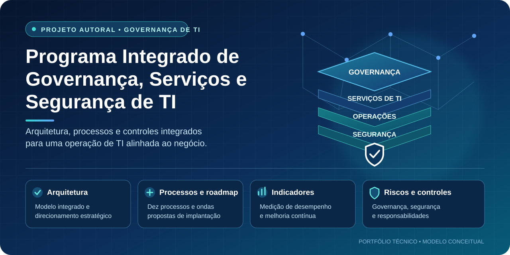

# Programa Integrado de Governança, Serviços e Segurança de TI

**SGS / SGSI — Projeto autoral e conceitual**

## Visão geral

Este projeto propõe um modelo integrado de Governança, Gestão de Serviços e Segurança da Informação, conectando estratégia, operação, riscos, compliance e melhoria contínua.

A arquitetura foi concebida para ser adaptada a organizações de diferentes portes e níveis de maturidade, considerando suas necessidades, prioridades e restrições.

## Objetivos

- Alinhar a estratégia de TI aos objetivos do negócio.
- Estruturar processos de gestão de serviços e operações.
- Fortalecer governança, riscos, controles internos e compliance.
- Melhorar a disponibilidade, a continuidade e a qualidade dos serviços.
- Promover eficiência operacional, financeira e melhoria contínua.
- Definir indicadores para acompanhamento executivo e operacional.

## Arquitetura integrada

O programa contempla dez processos interdependentes:

1. Gestão de Incidentes.
2. Gestão de Problemas e Base de Erros Conhecidos (KEDB).
3. Gestão de Mudanças e Liberações (GMUD).
4. Gestão de Níveis de Serviço (SLM) e Catálogo de Serviços.
5. Gestão de Continuidade de Serviços de TI (ITSCM) e Recuperação de Desastres (DRP).
6. Sistema de Gestão de Segurança da Informação (SGSI).
7. Gestão de Ativos de TI (ITAM) e Base de Dados de Configuração (CMDB).
8. Gestão de Fornecedores e Relacionamento com o Negócio (BRM).
9. Gestão de Demanda, Capacidade e FinOps.
10. Avaliação de Desempenho, Auditoria e Melhoria Contínua (CSI/PDCA).

## Roadmap de implantação

A proposta contempla um horizonte indicativo de até 18 meses, organizado em **cinco ondas de implantação** e **cinco marcos de transição (*Quality Gates*)**, com dependências entre processos, critérios de avaliação e pontos de controle.

O planejamento considera dois horizontes complementares:

- **Implantação inicial — até 90 dias:** diagnóstico, priorização e início dos processos considerados prioritários.
- **Evolução e maturação — até 18 meses:** desenvolvimento progressivo dos dez projetos, integração dos controles e consolidação das práticas de acompanhamento e melhoria contínua.

Os *Quality Gates* representam pontos propostos de avaliação das condições de avanço entre as ondas. Seus critérios, períodos e evidências esperadas estão descritos no documento detalhado.

O cronograma é conceitual e deve ser adaptado conforme o diagnóstico, os riscos, as dependências, os recursos e as prioridades de cada organização.

Para consultar as cinco ondas, os marcos de transição e os critérios propostos, acesse o [Roadmap — Fases, Ondas e Marcos de Transição](02-roadmap/roadmap-fases-marcos.md) e o [Roadmap Consolidado SGS/SGSI](docs/Roadmap_Consolidado_SGS_SGSI_v1_1_revisado.docx).

## Referenciais metodológicos

O modelo considera referenciais de governança, gestão de serviços, segurança da informação, riscos e continuidade, incluindo ISO/IEC 38500, ISO/IEC 20000-1, ISO/IEC 27001, COBIT, ITIL 4, ISO 31000, ISO 22301, LGPD e COSO.

A aplicabilidade de cada referência deverá ser avaliada conforme o contexto organizacional.

## Estrutura do projeto

- `01-arquitetura/` — Arquitetura e modelo de governança.
- `02-roadmap/` — Planejamento e ondas de implantação.
- `03-processos/` — Documentação dos dez processos.
- `04-governanca-e-controles/` — Riscos, responsabilidades e controles.
- `05-indicadores/` — Indicadores, metas e critérios de medição.
- `06-diagramas/` — Fluxos e arquitetura integrada.
- `docs/` — Glossário, premissas e referências.

## Natureza do projeto

Este é um projeto autoral e conceitual, desenvolvido como iniciativa independente para demonstrar uma abordagem integrada de governança de TI.

Valores financeiros, prazos, metas, indicadores e projeções são simulados para fins demonstrativos. Não representam resultados comprovados de uma implantação empresarial.

O modelo deve ser avaliado e adaptado antes de sua utilização em qualquer organização.

## Evolução

O projeto será aprofundado progressivamente por meio de procedimentos operacionais, matrizes de responsabilidades, fluxos, controles, indicadores e documentação específica para cada processo.

## Autor

José Eduardo Moura Cardozo

Gestão de TI | Governança (GRC) | Operações de TI | Melhoria Contínua

## Navegação do projeto

Explore os principais componentes do programa:

| Área | Conteúdo |
|---|---|
| [01 — Arquitetura](01-arquitetura/README.md) | Visão estrutural, domínios e componentes do modelo integrado SGS/SGSI. |
| [02 — Roadmap](02-roadmap/README.md) | Fases, marcos, dependências e horizontes de evolução do programa. |
| [03 — Processos](03-processos/README.md) | Catálogo dos dez processos de governança, serviços e segurança de TI. |
| [04 — Governança e Controles](04-governanca-e-controles/README.md) | Estrutura de governança, responsabilidades e controles. |
| [05 — Indicadores](05-indicadores/README.md) | Indicadores para acompanhamento executivo e operacional. |
| [06 — Diagramas](06-diagramas/README.md) | Representações visuais da arquitetura e dos fluxos do programa. |
| [Documentação central](docs/README.md) | Índice dos documentos de referência e materiais detalhados do projeto. |

### Como navegar pela documentação

As pastas temáticas apresentam sínteses, estruturas e diagramas para facilitar a compreensão do modelo. A pasta `docs/` concentra os documentos de referência completos.

Este repositório apresenta um **projeto autoral e conceitual**. Os modelos, processos e controles descritos não constituem comprovação de implantação em uma organização real.
